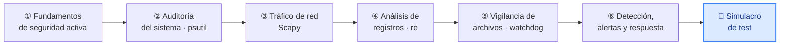
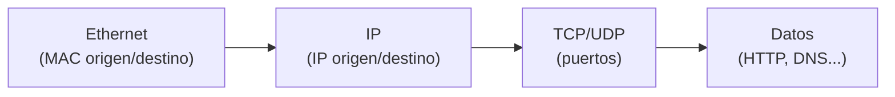

# Unidad 2 · Seguridad activa: auditoría, monitorización y defensa

| | |
|---|---|
| **Resultado de aprendizaje** | RA2 · Implanta mecanismos de seguridad activa |
| **Trimestre** | 1.º — se evalúa con **examen tipo test** |
| **Duración** | 16 horas |
| **Herramientas** | Python 3 · `psutil` · `scapy` · `watchdog` · Docker |

Esta unidad va de **defender un sistema que está en marcha**: vigilar lo que ocurre dentro (procesos, memoria, conexiones), analizar el tráfico que entra y sale, leer los registros en busca de patrones sospechosos, detectar cambios en los ficheros y, con todo ello, **decidir** una respuesta. No se trata de memorizar definiciones, sino de **ejecutar** herramientas reales y entender qué dice cada resultado.

Cada bloque sigue la misma estructura: una explicación técnica breve, ejemplos de código comentados, y **laboratorios completamente resueltos** que puedes levantar y ejecutar. La evaluación es un **examen tipo test**; al final tienes un simulacro calcado al examen.

!!! info "Cómo está organizada"
    Seis bloques independientes. Los bloques 2, 3, 4, 5 y 6 son prácticos y cada uno trae su laboratorio con todos los ficheros. El bloque 1 es la base conceptual.



## 0 · Preparación del entorno (común a todos los bloques)

Trabajarás con un **entorno virtual** de Python y, en algunos laboratorios, con **Docker**. Prepara esto una sola vez.

**Entorno virtual y dependencias.** Crea una carpeta `ut2` y dentro un fichero `requirements.txt`:

```text title="requirements.txt"
psutil==5.9.8
scapy==2.5.0
watchdog==4.0.0
```

```bash title="Terminal — crear el entorno"
mkdir ut2 && cd ut2
python -m venv .venv
source .venv/bin/activate          # Windows: .venv\Scripts\activate
pip install -r requirements.txt
```

**Docker.** Comprueba que está disponible (lo usarás en varios laboratorios):

```bash title="Terminal"
docker --version
docker compose version
```

!!! warning "Principio de mínimo privilegio en los contenedores"
    Ningún laboratorio usa el modo `privileged`, ni monta el socket de Docker del anfitrión, ni expone puertos innecesarios. Cada contenedor recibe **solo** los permisos que necesita. Cuando una práctica requiere capacidades especiales (por ejemplo, capturar tráfico), se indican de forma explícita y acotada.

---

# Bloque 1 · Fundamentos de seguridad activa

> **Objetivos didácticos:** distinguir seguridad activa de pasiva; relacionar amenaza, vulnerabilidad y riesgo; conocer los mecanismos de prevención, detección y respuesta (antivirus, firewall, IDS/IPS, actualizaciones, control de acceso, mínimo privilegio, defensa en profundidad).
> **Duración estimada:** 2 h.

## 1.1 Seguridad activa frente a seguridad pasiva

La **seguridad activa** agrupa las medidas que **previenen o detienen** un incidente *mientras el sistema funciona*: el antivirus que bloquea un fichero malicioso, el firewall que corta una conexión, el sistema que detecta y responde a un ataque. La **seguridad pasiva** son las medidas que **reducen el daño una vez que el incidente ya ha ocurrido**: las copias de seguridad, los sistemas redundantes, un SAI que mantiene la corriente.

| | Seguridad activa | Seguridad pasiva |
|---|---|---|
| Cuándo actúa | **Antes y durante** el incidente | **Después** del incidente |
| Objetivo | Evitar o detener el daño | Minimizar y recuperarse del daño |
| Ejemplos | Antivirus, firewall, IDS/IPS, control de acceso | Copias de seguridad, redundancia, SAI |

Esta unidad se centra en la **activa**: vigilar, detectar y responder.

## 1.2 Amenaza, vulnerabilidad y riesgo

Son tres conceptos distintos que conviene no confundir:

- **Amenaza:** lo que *podría* causar daño (un atacante, un malware, un fallo humano). No la controlas.
- **Vulnerabilidad:** la *debilidad* que la amenaza aprovecha (un servicio sin actualizar, una contraseña débil). **Sí** la controlas.
- **Riesgo:** la *probabilidad* de que una amenaza explote una vulnerabilidad, por el *impacto* que tendría.

> Reducir el riesgo consiste, sobre todo, en **eliminar vulnerabilidades**: es la parte sobre la que puedes actuar.

## 1.3 Mecanismos de defensa

| Mecanismo | Qué hace | Tipo |
|---|---|---|
| **Antivirus / EDR** | Detecta y bloquea software malicioso | Prevención + detección |
| **Firewall (cortafuegos)** | Filtra el tráfico de red según reglas | Prevención |
| **IDS** (*Intrusion Detection System*) | **Detecta** actividad sospechosa y **avisa** | Detección |
| **IPS** (*Intrusion Prevention System*) | Detecta **y además bloquea** el ataque | Detección + respuesta |
| **Actualizaciones de seguridad** | Cierran vulnerabilidades conocidas | Prevención |
| **Control de acceso** | Limita quién puede hacer qué | Prevención |

Dos diferencias que caen mucho en el examen:

- **IDS vs IPS:** el IDS solo **avisa**; el IPS **avisa y corta**. Un IDS es como una cámara de seguridad; un IPS, como una cámara conectada a una puerta que se cierra sola.
- **NIDS vs HIDS:** un **NIDS** vigila la *red* (el tráfico); un **HIDS** vigila un *equipo* concreto (sus procesos, sus ficheros). En esta unidad construirás piezas de ambos.

## 1.4 Dos principios que lo sostienen todo

**Mínimo privilegio.** Cada usuario, proceso o contenedor recibe **solo** los permisos que necesita para su función, ni uno más. Si un proceso con permisos mínimos es comprometido, el daño queda acotado. Es la razón por la que los contenedores de esta unidad no se ejecutan como `privileged`.

**Defensa en profundidad.** No se confía en una única barrera, sino en **varias capas** independientes: firewall + antivirus + monitorización + copias. Si una capa falla, las demás siguen protegiendo. Ninguna herramienta de esta unidad es "la solución"; cada una es **una capa**.

!!! note "Lo esencial del bloque 1 para el test"
    Activa = prevenir/detener (antes/durante) · pasiva = recuperar (después). IDS avisa, IPS avisa y bloquea. NIDS vigila la red, HIDS vigila un equipo. Mínimo privilegio = solo los permisos necesarios. Defensa en profundidad = varias capas.

---

# Bloque 2 · Auditoría y monitorización del sistema con `psutil`

> **Objetivos didácticos:** consultar procesos, CPU, memoria, usuarios y conexiones con `psutil`; entender qué se puede ver sin privilegios y cómo interpretar los resultados sin asumir que lo desconocido es malicioso.
> **Duración estimada:** 3 h.

## 2.1 Qué es `psutil` y qué permite ver

`psutil` (*process and system utilities*) es una librería que da acceso, desde Python, a información del sistema operativo: procesos en ejecución, uso de CPU y memoria, usuarios conectados y conexiones de red. Es multiplataforma (Linux, Windows, macOS) y es la base de muchas herramientas de monitorización.

**Primer ejemplo — una foto rápida del sistema:**

```python title="sistema.py"
import psutil
import platform

print("Sistema operativo:", platform.system(), platform.release())
print("Uso de CPU:", psutil.cpu_percent(interval=0.3), "%")

mem = psutil.virtual_memory()
print(f"Memoria: {mem.percent}% usada "
      f"({mem.used // (1024**2)} MB de {mem.total // (1024**2)} MB)")
```

```text title="Salida (los números varían según tu máquina)"
Sistema operativo: Linux 6.1.0
Uso de CPU: 4.0 %
Memoria: 42.3% usada (3380 MB de 7985 MB)
```

- `cpu_percent(interval=0.3)` mide durante 0,3 s y devuelve el porcentaje de uso. Sin intervalo, la primera llamada devuelve `0.0`.
- `virtual_memory()` devuelve un objeto con `.percent`, `.used`, `.total`… en **bytes** (por eso dividimos entre `1024**2` para pasar a MB).

## 2.2 Listar procesos

`process_iter(...)` recorre todos los procesos. Se le indica qué campos interesan para que sea eficiente. Cada proceso puede desaparecer mientras lo lees o estar protegido, así que **siempre** se captura la excepción.

```python title="procesos.py"
import psutil

def top_procesos_por_memoria(n: int = 5) -> list[tuple[float, int, str]]:
    procesos = []
    for p in psutil.process_iter(["pid", "name", "memory_percent"]):
        try:
            mem = p.info["memory_percent"] or 0.0
            procesos.append((mem, p.info["pid"], p.info["name"]))
        except (psutil.NoSuchProcess, psutil.AccessDenied):
            # El proceso murió o no tenemos permiso: lo ignoramos sin romper
            continue
    return sorted(procesos, reverse=True)[:n]

for mem_pct, pid, nombre in top_procesos_por_memoria(3):
    print(f"PID {pid:6}  {nombre:22}  {mem_pct:.1f}% memoria")
```

```text title="Salida (ejemplo)"
PID     56  rclone-filestore        0.9% memoria
PID    101  python3                 0.3% memoria
PID      1  process_api             0.1% memoria
```

!!! warning "Un proceso desconocido NO es automáticamente malicioso"
    Ver un proceso con un nombre que no reconoces es **normal**: el sistema ejecuta decenas de procesos legítimos. La monitorización te da **datos**, no veredictos. Antes de alarmarte, comprueba la ruta del ejecutable, el usuario que lo lanza y si tiene conexiones de red; y contrástalo. Asumir que "lo que no conozco es un virus" genera falsos positivos y hace perder el tiempo.

## 2.3 Conexiones de red y usuarios

```python title="red_usuarios.py"
import psutil

print("=== Usuarios con sesión abierta ===")
for u in psutil.users():
    print(f"  {u.name}  (terminal: {u.terminal})")

print("\n=== Conexiones de red establecidas ===")
try:
    for c in psutil.net_connections(kind="inet"):
        if c.status == "ESTABLISHED" and c.raddr:
            print(f"  {c.laddr.ip}:{c.laddr.port}  <->  {c.raddr.ip}:{c.raddr.port}")
except psutil.AccessDenied:
    print("  AccessDenied: para ver TODAS las conexiones hacen falta privilegios.")
```

```text title="Salida (ejemplo)"
=== Usuarios con sesión abierta ===
  ivan  (terminal: pts/0)

=== Conexiones de red establecidas ===
  10.0.0.5:60680  <->  93.184.216.34:443
```

## 2.4 Límites al ejecutar sin privilegios

Esto es clave para interpretar lo que ves, **sobre todo dentro de un contenedor**:

- Sin privilegios de administrador, `psutil` ve **tus** procesos y los que el sistema te deja ver, pero puede devolver `AccessDenied` al consultar detalles de procesos de otros usuarios.
- **Dentro de un contenedor Docker**, por aislamiento, normalmente solo ves los procesos **de ese contenedor**, no los del equipo anfitrión ni los de otros contenedores. Esto es una característica de seguridad, no un fallo.
- `net_connections()` puede requerir privilegios para listar **todas** las conexiones del sistema.

> **Conclusión práctica:** si quieres auditar el *contenedor*, ejecútalo dentro del contenedor. Si quieres auditar el *equipo anfitrión*, ejecuta el script directamente en el sistema operativo (fuera de Docker). No son lo mismo.

## 2.5 🧪 Laboratorio 2 · Auditoría de un contenedor con `psutil`

**Objetivo.** Ejecutar un auditor de sistema dentro de un contenedor con privilegios mínimos y comprobar qué información ofrece sobre su propio entorno.

**Conceptos que enseña.** Lectura de procesos/memoria/conexiones; aislamiento de contenedores; mínimo privilegio; interpretación prudente de los datos.

**Ficheros necesarios** (créalos en una carpeta `lab2/`):

```python title="lab2/auditor.py"
import psutil
import platform

def informe() -> None:
    print("=== INFORME DE AUDITORÍA DEL SISTEMA ===")
    print("SO:", platform.system(), platform.release())
    print("CPU:", psutil.cpu_percent(interval=0.3), "%")

    mem = psutil.virtual_memory()
    print(f"Memoria: {mem.percent}% ({mem.used // (1024**2)} MB / {mem.total // (1024**2)} MB)")

    print("\n-- Procesos visibles (top 5 por memoria) --")
    procesos = []
    for p in psutil.process_iter(["pid", "name", "memory_percent"]):
        try:
            procesos.append((p.info["memory_percent"] or 0.0, p.info["pid"], p.info["name"]))
        except (psutil.NoSuchProcess, psutil.AccessDenied):
            continue
    for mem_pct, pid, nombre in sorted(procesos, reverse=True)[:5]:
        print(f"  PID {pid:6}  {nombre:22}  {mem_pct:.1f}%")

    print(f"\nTotal de procesos visibles: {len(procesos)}")
    print("(Dentro de un contenedor, estos son los procesos DE ESE contenedor.)")

if __name__ == "__main__":
    informe()
```

```text title="lab2/requirements.txt"
psutil==5.9.8
```

```dockerfile title="lab2/Dockerfile"
FROM python:3.12-slim
WORKDIR /app
COPY requirements.txt .
RUN pip install --no-cache-dir -r requirements.txt
COPY auditor.py .
# Usuario sin privilegios (mínimo privilegio)
RUN useradd --create-home auditor
USER auditor
CMD ["python", "auditor.py"]
```

```yaml title="lab2/compose.yaml"
services:
  auditor:
    build: .
    # Sin privilegios especiales, sin puertos, sin volúmenes del host
    read_only: true
    security_opt:
      - no-new-privileges:true
```

**Cómo levantarlo y ejecutarlo:**

```bash title="Terminal (dentro de lab2/)"
docker compose build
docker compose run --rm auditor
```

**Salida esperada** (los números varían):

```text
=== INFORME DE AUDITORÍA DEL SISTEMA ===
SO: Linux 6.1.0
CPU: 0.0 %
Memoria: 3.1% (120 MB / 3997 MB)

-- Procesos visibles (top 5 por memoria) --
  PID      1  python                  0.4%

Total de procesos visibles: 1
(Dentro de un contenedor, estos son los procesos DE ESE contenedor.)
```

**Explicación del resultado.** El contenedor ve **un solo proceso** (el propio `python`), porque está aislado: no ve los procesos del anfitrión. La memoria total que reporta es la del anfitrión (el kernel es compartido), pero los procesos son los suyos. Esto demuestra el **aislamiento** y por qué, para auditar el equipo real, hay que ejecutar el script fuera de Docker.

**Procedimiento alternativo (auditar el anfitrión).** Si necesitas auditar tu propio equipo, ejecuta el script directamente, sin contenedor:

```bash title="Terminal (en el anfitrión, con el venv activado)"
python lab2/auditor.py
```

Ahí verás **todos** los procesos de tu sesión (y más, si lo ejecutas con privilegios de administrador).

**Errores habituales.**

| Síntoma | Causa | Solución |
|---|---|---|
| `AccessDenied` al leer un proceso | Proceso de otro usuario / protegido | Captúralo y continúa (ya lo hace el código) |
| El contenedor solo ve 1 proceso | Es lo normal: aislamiento | No es un error; para ver el host, ejecuta fuera de Docker |
| `cpu_percent` devuelve `0.0` | Llamada sin `interval` | Usa `interval=0.3` como en el ejemplo |

!!! note "Lo esencial del bloque 2 para el test"
    `psutil` lee procesos, CPU, memoria, conexiones y usuarios. `cpu_percent` necesita `interval`. Siempre se capturan `NoSuchProcess`/`AccessDenied`. Un contenedor ve **solo sus** procesos (aislamiento). Un proceso desconocido **no** es automáticamente malicioso.
---

# Bloque 3 · Análisis de tráfico de red con Scapy

> **Objetivos didácticos:** entender qué es un paquete y sus capas; identificar IP, TCP, UDP, ICMP y DNS; leer ficheros PCAP, filtrar paquetes, extraer orígenes/destinos y contar comunicaciones con Scapy. Conocer las limitaciones de la captura en vivo (permisos, Docker) frente al análisis de una captura ya hecha.
> **Duración estimada:** 3,5 h.

## 3.1 Qué es un paquete y sus capas

Cuando dos equipos se comunican por red, la información viaja en **paquetes**. Cada paquete está formado por **capas**, como una cebolla: cada capa añade su propia cabecera con su información.



| Capa | Qué información lleva | Ejemplo |
|---|---|---|
| **Ethernet** | Direcciones MAC (hardware) | `00:11:22:...` |
| **IP** | Direcciones IP origen y destino | `10.0.0.5 → 10.0.0.1` |
| **TCP / UDP** | Puertos (qué servicio) | puerto 80 (HTTP), 443 (HTTPS) |
| **ICMP** | Mensajes de control (ping) | "echo request" |
| **DNS** | Resolución de nombres | `ejemplo.local → 10.0.0.1` |

**Diferencias que importan:**

- **TCP** establece conexión (con el saludo SYN → SYN-ACK → ACK) y garantiza la entrega: web, SSH, correo. **UDP** no establece conexión, es más rápido y sin garantías: DNS, streaming.
- **ICMP** no transporta datos de usuario: son mensajes de control (el `ping` usa ICMP).
- Las **banderas (flags) TCP** indican el estado: `S` (SYN, inicio), `SA` (SYN-ACK, respuesta), `A` (ACK, confirmación). Muchos `S` sin completar el saludo pueden indicar un **escaneo de puertos**.

## 3.2 Scapy: crear y leer paquetes

**Scapy** es una librería de Python para construir, enviar, capturar y analizar paquetes de red. En esta unidad la usamos **sin Wireshark**: todo el análisis se hace con código.

Los paquetes se construyen apilando capas con el operador `/`:

```python title="construir.py"
from scapy.all import IP, TCP

# Un paquete IP que contiene un segmento TCP hacia el puerto 80
paquete = IP(src="10.0.0.5", dst="10.0.0.1") / TCP(dport=80, flags="S")

print(paquete.summary())          # resumen en una línea
print("IP origen:", paquete[IP].src)
print("Puerto destino:", paquete[TCP].dport)
```

```text title="Salida"
IP / TCP 10.0.0.5:ftp_data > 10.0.0.1:http S
IP origen: 10.0.0.5
Puerto destino: 80
```

- `paquete[IP]` accede a la capa IP; `paquete[TCP]` a la capa TCP.
- `paquete.haslayer(TCP)` indica si el paquete tiene esa capa (lo usaremos para filtrar).

## 3.3 Trabajar con ficheros PCAP

Un **PCAP** (*packet capture*) es un fichero que guarda paquetes capturados. Es el formato estándar y lo que vas a analizar: es **reproducible** (siempre da el mismo resultado) y **seguro** (no capturas tráfico real de nadie). Se escribe con `wrpcap` y se lee con `rdpcap`.

```python title="leer_pcap.py"
from scapy.all import rdpcap, IP

paquetes = rdpcap("trafico.pcap")      # devuelve una lista de paquetes
print("Paquetes en el fichero:", len(paquetes))

for p in paquetes[:3]:                  # los 3 primeros
    if p.haslayer(IP):
        print(f"{p[IP].src} -> {p[IP].dst}")
```

## 3.4 🧪 Laboratorio 3 · Analizar una captura de laboratorio

**Objetivo.** Generar un fichero PCAP de laboratorio (sin capturar tráfico real) y analizarlo: contar protocolos, listar conversaciones, extraer puertos y consultas DNS.

**Conceptos que enseña.** Capas de red; lectura de PCAP; filtrado por protocolo; extracción de IP/puertos; recuento de comunicaciones.

**Ficheros** (en `lab3/`):

```python title="lab3/generar_pcap.py"
from scapy.all import Ether, IP, TCP, UDP, ICMP, DNS, DNSQR, wrpcap

# Tráfico de laboratorio: un saludo TCP, una consulta DNS, un ping,
# y una IP que toca varios puertos (patrón de escaneo).
paquetes = [
    Ether()/IP(src="10.0.0.5", dst="10.0.0.1")/TCP(sport=44321, dport=80, flags="S"),
    Ether()/IP(src="10.0.0.1", dst="10.0.0.5")/TCP(sport=80, dport=44321, flags="SA"),
    Ether()/IP(src="10.0.0.5", dst="10.0.0.1")/TCP(sport=44321, dport=80, flags="A"),
    Ether()/IP(src="10.0.0.5", dst="8.8.8.8")/UDP(sport=5353, dport=53)/DNS(rd=1, qd=DNSQR(qname="ejemplo.local")),
    Ether()/IP(src="10.0.0.9", dst="10.0.0.1")/ICMP(),
    Ether()/IP(src="10.0.0.9", dst="10.0.0.1")/TCP(sport=51000, dport=22, flags="S"),
    Ether()/IP(src="10.0.0.9", dst="10.0.0.1")/TCP(sport=51001, dport=23, flags="S"),
    Ether()/IP(src="10.0.0.9", dst="10.0.0.1")/TCP(sport=51002, dport=445, flags="S"),
]
wrpcap("trafico.pcap", paquetes)
print(f"Creado trafico.pcap con {len(paquetes)} paquetes")
```

```python title="lab3/analizar.py"
from scapy.all import rdpcap, IP, TCP, UDP, ICMP, DNS
from collections import Counter

def analizar(ruta: str) -> None:
    paquetes = rdpcap(ruta)
    print(f"Paquetes leídos: {len(paquetes)}\n")

    protocolos: Counter[str] = Counter()
    conversaciones: Counter[tuple[str, str]] = Counter()
    puertos_tcp: Counter[int] = Counter()
    consultas_dns: list[str] = []

    for p in paquetes:
        if p.haslayer(TCP):
            protocolos["TCP"] += 1
            puertos_tcp[p[TCP].dport] += 1
        elif p.haslayer(UDP):
            protocolos["UDP"] += 1
        elif p.haslayer(ICMP):
            protocolos["ICMP"] += 1
        if p.haslayer(IP):
            conversaciones[(p[IP].src, p[IP].dst)] += 1
        if p.haslayer(DNS) and p[DNS].qd is not None:
            consultas_dns.append(p[DNS].qd.qname.decode())

    print("Protocolos:", dict(protocolos))
    print("\nConversaciones (origen -> destino):")
    for (src, dst), n in conversaciones.most_common():
        print(f"  {src:12} -> {dst:12}  {n}")
    print("\nPuertos destino TCP más contactados:")
    for puerto, n in puertos_tcp.most_common(5):
        print(f"  puerto {puerto:5}  {n} intento(s)")
    print("\nConsultas DNS:")
    for q in consultas_dns:
        print(f"  {q}")

if __name__ == "__main__":
    analizar("trafico.pcap")
```

```text title="lab3/requirements.txt"
scapy==2.5.0
```

```dockerfile title="lab3/Dockerfile"
FROM python:3.12-slim
WORKDIR /app
COPY requirements.txt .
RUN pip install --no-cache-dir -r requirements.txt
COPY generar_pcap.py analizar.py .
# Analizar un PCAP NO requiere privilegios de red: usuario sin privilegios
RUN useradd --create-home analista
USER analista
CMD ["sh", "-c", "python generar_pcap.py && python analizar.py"]
```

```yaml title="lab3/compose.yaml"
services:
  analista:
    build: .
    read_only: false      # necesita escribir trafico.pcap en /app
    security_opt:
      - no-new-privileges:true
```

**Ejecución:**

```bash title="Terminal (dentro de lab3/)"
docker compose build
docker compose run --rm analista
```

**Salida esperada:**

```text
Creado trafico.pcap con 8 paquetes
Paquetes leídos: 8

Protocolos: {'TCP': 6, 'UDP': 1, 'ICMP': 1}

Conversaciones (origen -> destino):
  10.0.0.9     -> 10.0.0.1      4
  10.0.0.5     -> 10.0.0.1      2
  10.0.0.1     -> 10.0.0.5      1
  10.0.0.5     -> 8.8.8.8       1

Puertos destino TCP más contactados:
  puerto    80  2 intento(s)
  puerto 44321  1 intento(s)
  puerto    22  1 intento(s)
  puerto    23  1 intento(s)
  puerto   445  1 intento(s)

Consultas DNS:
  ejemplo.local.
```

**Explicación del resultado.** La IP `10.0.0.9` aparece como la más activa, tocando **cuatro** destinos distintos en el mismo host, incluidos los puertos 22 (SSH), 23 (Telnet) y 445 (SMB), todos con bandera `S` (SYN) sin completar el saludo: es el **patrón típico de un escaneo de puertos**. `10.0.0.5`, en cambio, completa un saludo normal al puerto 80 y hace una consulta DNS legítima. Analizar el PCAP nos ha permitido **distinguir** un comportamiento sospechoso de uno normal, sin tocar la red real.

## 3.5 Captura en vivo: requisitos y límites (importante)

Analizar un PCAP ya existente es seguro y reproducible. **Capturar** tráfico en tiempo real es muy distinto y tiene requisitos estrictos:

- **Permisos.** Capturar requiere privilegios especiales sobre la interfaz de red (en Linux, la *capability* `CAP_NET_RAW`). Un usuario normal no puede hacerlo.
- **Qué se ve.** Una interfaz solo ve, por defecto, **su propio** tráfico y el de difusión. No ves "todo el tráfico de la red" salvo configuraciones especiales (puerto espejo en el switch, modo promiscuo…).
- **Docker.** Un contenedor **no** observa automáticamente el tráfico de los demás contenedores por compartir una red Docker: el conmutador virtual entrega a cada uno solo lo suyo. Para capturar en un contenedor haría falta otorgarle explícitamente `cap_add: [NET_RAW, NET_ADMIN]`, lo que **rompe el mínimo privilegio** y por eso **no** se hace en estos laboratorios.

> **Regla de la unidad:** priorizamos **PCAP preparados y análisis reproducible**. La captura en vivo se explica, pero no se fuerza dentro de Docker, porque requeriría privilegios que contradicen el diseño seguro del laboratorio.

Si quieres ver una captura en vivo de forma controlada, hazlo **en tu propia máquina**, sobre `localhost`, y con privilegios, generando tú el tráfico:

```python title="captura_local.py — solo en tu máquina, NO en Docker"
# Requiere privilegios: en Linux, ejecutar con sudo.
# Captura 5 paquetes de la interfaz de loopback (tu propio tráfico local).
from scapy.all import sniff

paquetes = sniff(iface="lo", count=5, timeout=10)
paquetes.summary()
```

**Errores habituales.**

| Síntoma | Causa | Solución |
|---|---|---|
| `PermissionError` al usar `sniff` | Captura sin privilegios | Ejecuta con `sudo` (solo en tu máquina, no en Docker) |
| El contenedor no ve tráfico de otros | Aislamiento de red: es lo normal | Analiza un PCAP; no des por hecho que verás tráfico ajeno |
| `qname` da error al decodificar | El paquete no tiene capa DNS | Comprueba `p.haslayer(DNS)` y `p[DNS].qd is not None` |

!!! note "Lo esencial del bloque 3 para el test"
    Paquete = capas (Ethernet/IP/TCP-UDP/datos). TCP tiene saludo (S/SA/A) y garantías; UDP no. PCAP = captura guardada; `rdpcap` la lee, `wrpcap` la escribe. `haslayer()` filtra. Muchos SYN a puertos distintos = escaneo. Capturar en vivo necesita privilegios (`CAP_NET_RAW`) y no ves el tráfico ajeno por compartir red Docker.
---

# Bloque 4 · Análisis de registros de seguridad

> **Objetivos didácticos:** leer registros con `pathlib`, extraer información con `re`, contar eventos con `collections` y detectar patrones sospechosos (fallos de autenticación repetidos). Establecer umbrales e interpretar resultados evitando falsos positivos.
> **Duración estimada:** 3 h.

## 4.1 Qué es un registro (log) y por qué importa

Un **registro** o *log* es un fichero de texto donde el sistema y los servicios anotan lo que va ocurriendo: inicios de sesión, errores, conexiones. En Linux, el registro de autenticación suele estar en `/var/log/auth.log`. Analizarlos permite **detectar** comportamientos anómalos, como muchos intentos de login fallidos seguidos.

El patrón de un ataque de **fuerza bruta** por SSH deja líneas como:

```text
Failed password for root from 203.0.113.9 port 51000
```

Si una misma IP acumula muchas de estas, es un **indicio** que merece revisión.

## 4.2 Las tres herramientas: `pathlib`, `re` y `collections`

- **`pathlib`** lee el fichero de forma sencilla: `Path("auth.log").read_text()`.
- **`re`** (expresiones regulares) extrae los datos que interesan de cada línea.
- **`collections.Counter`** cuenta de forma cómoda.

```python title="contar_fallos.py"
import re
from collections import Counter

PATRON = re.compile(r"Failed password for \S+ from (\d+\.\d+\.\d+\.\d+)")

lineas = [
    "Failed password for root from 203.0.113.9 port 51000",
    "Failed password for admin from 203.0.113.9 port 51004",
    "Accepted password for ana from 10.0.0.5 port 60000",
]

fallos = Counter()
for linea in lineas:
    m = PATRON.search(linea)
    if m:                       # solo cuenta las líneas de FALLO
        fallos[m.group(1)] += 1

print(dict(fallos))
```

```text title="Salida"
{'203.0.113.9': 2}
```

El `if m:` es esencial: `re.search` devuelve `None` si la línea no encaja (por ejemplo, la de `Accepted`), y así no la contamos.

## 4.3 Umbrales y falsos positivos

¿A partir de cuántos fallos consideramos sospechosa una IP? Eso es el **umbral**. Elegirlo bien es un equilibrio:

- Un umbral **muy bajo** (p. ej., 2) genera **falsos positivos**: un usuario que se equivoca dos veces al escribir su contraseña no es un atacante.
- Un umbral **muy alto** deja pasar ataques lentos.

> **Principio fundamental:** superar un umbral indica un **patrón compatible** con un ataque, **no** demuestra que haya ocurrido uno. Un pico de fallos puede ser un script mal configurado, un usuario despistado o un sistema de copias con credenciales caducadas. La detección **señala para investigar**, no condena.

## 4.4 🧪 Laboratorio 4 · Detector de fuerza bruta en logs

**Objetivo.** Leer un registro de autenticación, contar los fallos por IP, aplicar un umbral y señalar las IP a revisar, sin afirmar que haya un ataque confirmado.

**Conceptos que enseña.** Lectura de ficheros; extracción con regex; recuento; umbrales; interpretación prudente.

**Ficheros** (en `lab4/`):

```text title="lab4/auth.log"
2026-05-01T08:00:01 sshd: Failed password for root from 203.0.113.9 port 51000
2026-05-01T08:00:03 sshd: Failed password for root from 203.0.113.9 port 51002
2026-05-01T08:00:05 sshd: Failed password for admin from 203.0.113.9 port 51004
2026-05-01T08:00:07 sshd: Failed password for root from 198.51.100.7 port 40000
2026-05-01T08:00:12 sshd: Failed password for root from 203.0.113.9 port 51006
2026-05-01T08:00:30 sshd: Accepted password for ana from 10.0.0.5 port 60000
2026-05-01T08:01:00 sshd: Failed password for guest from 203.0.113.9 port 51008
```

```python title="lab4/detectar.py"
import re
from collections import Counter
from pathlib import Path

PATRON_FALLO = re.compile(
    r"Failed password for (?P<usuario>\S+) from (?P<ip>\d+\.\d+\.\d+\.\d+)")

def analizar_log(ruta: Path, umbral: int = 3) -> None:
    texto = ruta.read_text(encoding="utf-8")

    fallos_por_ip: Counter[str] = Counter()
    usuarios_por_ip: dict[str, set[str]] = {}

    for linea in texto.splitlines():
        m = PATRON_FALLO.search(linea)
        if m:
            ip = m.group("ip")
            fallos_por_ip[ip] += 1
            usuarios_por_ip.setdefault(ip, set()).add(m.group("usuario"))

    print("=== Fallos de autenticación por IP ===")
    for ip, n in fallos_por_ip.most_common():
        usuarios = ", ".join(sorted(usuarios_por_ip[ip]))
        print(f"  {ip:16} {n} fallos  (usuarios: {usuarios})")

    print(f"\n=== IPs que superan el umbral ({umbral}) ===")
    hay_alertas = False
    for ip, n in fallos_por_ip.items():
        if n >= umbral:
            hay_alertas = True
            print(f"  [REVISAR] {ip}: {n} fallos con "
                  f"{len(usuarios_por_ip[ip])} usuario(s) distinto(s)")
    if not hay_alertas:
        print("  (ninguna)")

    print("\nNota: un umbral superado es un PATRÓN sospechoso que hay que verificar,")
    print("no una prueba de ataque por sí solo.")

if __name__ == "__main__":
    analizar_log(Path("auth.log"), umbral=3)
```

```dockerfile title="lab4/Dockerfile"
FROM python:3.12-slim
WORKDIR /app
COPY detectar.py auth.log .
RUN useradd --create-home analista
USER analista
CMD ["python", "detectar.py"]
```

```yaml title="lab4/compose.yaml"
services:
  analista:
    build: .
    read_only: true
    security_opt:
      - no-new-privileges:true
```

> Este laboratorio **no** necesita dependencias externas (`re`, `collections` y `pathlib` son de la biblioteca estándar), por eso no hay `requirements.txt`.

**Ejecución:**

```bash title="Terminal (dentro de lab4/)"
docker compose build
docker compose run --rm analista
```

**Salida esperada:**

```text
=== Fallos de autenticación por IP ===
  203.0.113.9      5 fallos  (usuarios: admin, guest, root)
  198.51.100.7     1 fallos  (usuarios: root)

=== IPs que superan el umbral (3) ===
  [REVISAR] 203.0.113.9: 5 fallos con 3 usuario(s) distinto(s)

Nota: un umbral superado es un PATRÓN sospechoso que hay que verificar,
no una prueba de ataque por sí solo.
```

**Explicación del resultado.** La IP `203.0.113.9` acumula 5 fallos contra 3 usuarios distintos (`root`, `admin`, `guest`): probar varios usuarios desde una misma IP es característico de fuerza bruta. `198.51.100.7` solo tiene 1 fallo, por debajo del umbral, así que **no** se marca — evitamos un falso positivo. La línea `Accepted` de `ana` no se cuenta porque el patrón solo captura `Failed`.

**Errores habituales.**

| Síntoma | Causa | Solución |
|---|---|---|
| Cuenta también los `Accepted` | Patrón demasiado amplio | El regex solo debe capturar `Failed password` |
| `AttributeError: NoneType` | Usar `m.group()` sin comprobar `if m:` | Comprueba siempre que hubo coincidencia |
| No detecta nada | Umbral demasiado alto | Ajusta el umbral al volumen real de tu log |

!!! note "Lo esencial del bloque 4 para el test"
    `pathlib` lee, `re` extrae, `Counter` cuenta. `re.search` devuelve `None` si no encaja → comprobar `if m:`. El umbral equilibra falsos positivos y ataques no detectados. Superar un umbral = patrón a **investigar**, no prueba de ataque.

---

# Bloque 5 · Protección del sistema y vigilancia de archivos

> **Objetivos didácticos:** entender permisos, mínimo privilegio, actualizaciones, firewall y copias como capas de protección; usar `watchdog` para detectar creación, modificación, renombrado y borrado de ficheros en un directorio. Conocer los límites de la vigilancia de archivos.
> **Duración estimada:** 2,5 h.

## 5.1 Las capas de protección del sistema

Proteger un sistema en marcha combina varias medidas, cada una una **capa** (defensa en profundidad):

| Medida | Qué aporta |
|---|---|
| **Permisos y mínimo privilegio** | Cada usuario/proceso accede solo a lo necesario |
| **Actualizaciones** | Cierran vulnerabilidades conocidas |
| **Firewall** | Filtra el tráfico de red |
| **Copias de seguridad** | Permiten recuperarse (seguridad pasiva) |
| **Vigilancia de archivos** | Detecta cambios no esperados en ficheros clave |

La **vigilancia de archivos** avisa cuando algo modifica, crea o borra ficheros que no deberían cambiar (por ejemplo, los de configuración del sistema). Es una técnica de tipo **HIDS** (vigila un equipo concreto).

## 5.2 `watchdog`: reaccionar a cambios en ficheros

`watchdog` observa un directorio y **ejecuta código** cuando ocurre un evento: creación, modificación, borrado o renombrado. Se define un *manejador* (una clase que hereda de `FileSystemEventHandler`) con un método por tipo de evento.

```python title="eventos.py"
from watchdog.events import FileSystemEventHandler

class MiManejador(FileSystemEventHandler):
    def on_created(self, event):    # se crea un fichero o carpeta
        print("CREADO:", event.src_path)
    def on_modified(self, event):   # se modifica
        print("MODIFICADO:", event.src_path)
    def on_deleted(self, event):    # se borra
        print("BORRADO:", event.src_path)
    def on_moved(self, event):      # se renombra o mueve
        print("MOVIDO:", event.src_path, "->", event.dest_path)
```

Un `Observer` conecta ese manejador con una carpeta y se queda escuchando en segundo plano.

!!! warning "La vigilancia de archivos NO sustituye a un antivirus"
    `watchdog` te dice que *algo cambió*, pero no *si ese cambio es malicioso*. Una actualización legítima también modifica ficheros. Es una capa de **detección de cambios**, útil combinada con otras (un antivirus analiza el contenido; aquí solo observamos eventos). Tampoco detecta cambios si el fichero se modifica mientras el vigilante no está en marcha.

## 5.3 🧪 Laboratorio 5 · Vigilante de un directorio

**Objetivo.** Vigilar una carpeta y registrar en tiempo real los cuatro tipos de evento (creación, modificación, renombrado, borrado).

**Conceptos que enseña.** Manejadores de eventos de ficheros; observación en segundo plano; HIDS básico; límites de la técnica.

**Ficheros** (en `lab5/`):

```python title="lab5/vigilar.py"
import sys
import time
from pathlib import Path
from watchdog.observers import Observer
from watchdog.events import FileSystemEventHandler

class VigilanteDeArchivos(FileSystemEventHandler):
    def _marca(self, tipo: str, ruta: str) -> None:
        print(f"{time.strftime('%H:%M:%S')}  [{tipo:11}] {ruta}", flush=True)

    def on_created(self, event):
        if not event.is_directory:
            self._marca("CREADO", event.src_path)

    def on_modified(self, event):
        if not event.is_directory:
            self._marca("MODIFICADO", event.src_path)

    def on_deleted(self, event):
        if not event.is_directory:
            self._marca("BORRADO", event.src_path)

    def on_moved(self, event):
        self._marca("RENOMBRADO", f"{event.src_path} -> {event.dest_path}")

def vigilar(carpeta: str, segundos: int) -> None:
    Path(carpeta).mkdir(parents=True, exist_ok=True)
    observador = Observer()
    observador.schedule(VigilanteDeArchivos(), carpeta, recursive=True)
    observador.start()
    print(f"Vigilando {carpeta} durante {segundos}s...", flush=True)
    try:
        time.sleep(segundos)
    finally:
        observador.stop()
        observador.join()
    print("Vigilancia terminada.", flush=True)

if __name__ == "__main__":
    carpeta = sys.argv[1] if len(sys.argv) > 1 else "vigilada"
    segundos = int(sys.argv[2]) if len(sys.argv) > 2 else 30
    vigilar(carpeta, segundos)
```

```python title="lab5/provocar.py"
# Genera eventos sobre la carpeta vigilada, para la demostración.
import time
from pathlib import Path

carpeta = Path("vigilada")
carpeta.mkdir(exist_ok=True)
time.sleep(1)
(carpeta / "documento.txt").write_text("contenido inicial"); time.sleep(0.5)
(carpeta / "documento.txt").write_text("contenido modificado"); time.sleep(0.5)
(carpeta / "documento.txt").rename(carpeta / "renombrado.txt"); time.sleep(0.5)
(carpeta / "renombrado.txt").unlink()
print("Eventos provocados.")
```

```text title="lab5/requirements.txt"
watchdog==4.0.0
```

```dockerfile title="lab5/Dockerfile"
FROM python:3.12-slim
WORKDIR /app
COPY requirements.txt .
RUN pip install --no-cache-dir -r requirements.txt
COPY vigilar.py provocar.py .
RUN useradd --create-home vigilante && mkdir -p /app/vigilada && chown vigilante /app/vigilada
USER vigilante
# Lanza el vigilante 8s y, en paralelo, provoca los eventos
CMD ["sh", "-c", "python vigilar.py vigilada 8 & sleep 1 && python provocar.py && wait"]
```

```yaml title="lab5/compose.yaml"
services:
  vigilante:
    build: .
    security_opt:
      - no-new-privileges:true
```

**Ejecución:**

```bash title="Terminal (dentro de lab5/)"
docker compose build
docker compose run --rm vigilante
```

**Salida esperada** (las horas varían):

```text
Vigilando vigilada durante 8s...
07:01:40  [CREADO     ] vigilada/documento.txt
07:01:40  [MODIFICADO ] vigilada/documento.txt
07:01:41  [RENOMBRADO ] vigilada/documento.txt -> vigilada/renombrado.txt
07:01:41  [BORRADO    ] vigilada/renombrado.txt
Eventos provocados.
Vigilancia terminada.
```

**Explicación del resultado.** El vigilante detecta en tiempo real cada operación: la creación del fichero, su modificación, el renombrado (un único evento `on_moved` con origen y destino) y el borrado. Es exactamente lo que haría un HIDS vigilando `/etc` para avisar si alguien altera la configuración. Puede aparecer más de un `MODIFICADO` por operación, porque el sistema de ficheros emite varios eventos internos al escribir — es normal.

**Errores habituales.**

| Síntoma | Causa | Solución |
|---|---|---|
| No detecta nada | La carpeta vigilada no existe o es otra | `mkdir` la carpeta y vigila la ruta correcta |
| Varios `MODIFICADO` por un cambio | El SO emite varios eventos al escribir | Es normal; se puede "desduplicar" por tiempo si molesta |
| El vigilante termina enseguida | Se acabó el tiempo de `time.sleep` | Aumenta los segundos o déjalo en un bucle |

!!! note "Lo esencial del bloque 5 para el test"
    `watchdog` detecta CREADO/MODIFICADO/BORRADO/MOVIDO con un `FileSystemEventHandler` + `Observer`. Es una técnica HIDS. **No** sustituye a un antivirus: avisa de que *algo cambió*, no de si es malicioso, y no ve cambios hechos mientras no estaba activo.

---

# Bloque 6 · Detección, alertas y respuesta defensiva

> **Objetivos didácticos:** correlacionar evidencias de varias fuentes (sistema, red, logs, archivos); aplicar reglas de detección y niveles de gravedad; registrar alertas con `logging` y `json`; razonar decisiones defensivas evitando falsos positivos.
> **Duración estimada:** 2 h.

## 6.1 De la observación a la decisión

En los bloques anteriores has recogido **evidencias** por separado: procesos (psutil), tráfico (Scapy), fallos de login (logs), cambios de ficheros (watchdog). La defensa real consiste en **juntarlas** y decidir. Una sola evidencia puede ser ruido; **varias que apuntan a lo mismo** son una señal fuerte.

> Ejemplo: una IP con muchos fallos de login *y además* escaneando puertos *y además* asociada a un cambio en `/etc/passwd` es mucho más preocupante que cualquiera de esas tres cosas por separado. Eso es **correlación**.

## 6.2 Reglas, gravedad y registro

- **Regla de detección:** una condición que, si se cumple, genera una alerta (p. ej., "≥ 3 fallos de la misma IP").
- **Nivel de gravedad:** `BAJA`, `MEDIA`, `ALTA`, `CRITICA`. Ayuda a priorizar: no todo merece la misma reacción.
- **Registro de alertas:** se guardan con `logging` (para verlas en tiempo real) y en formato `json` (para que otra herramienta las procese).

**Falsos positivos.** Igual que en los logs, una regla puede saltar sin que haya ataque. Por eso una buena alerta incluye el **porqué** (qué evidencia la disparó), para que una persona pueda verificarla rápido.

## 6.3 Medidas correctoras (respuesta)

Cuando una alerta se confirma, la respuesta defensiva puede ser: **bloquear** la IP en el firewall, **aislar** el equipo afectado de la red, **forzar** el cambio de credenciales, **restaurar** ficheros desde copia y **documentar** el incidente. La automatización (un IPS) puede aplicar algunas de inmediato; otras requieren decisión humana.

## 6.4 🧪 Laboratorio 6 · Correlacionar evidencias y generar alertas

**Objetivo.** Partir de una lista de evidencias de distintas fuentes, aplicar reglas de detección con niveles de gravedad, correlacionar y registrar las alertas con `logging` y `json`.

**Conceptos que enseña.** Correlación de fuentes; reglas; gravedad; registro estructurado; justificación de decisiones.

**Ficheros** (en `lab6/`):

```python title="lab6/correlacionar.py"
import json
import logging
from dataclasses import dataclass

logging.basicConfig(level=logging.INFO, format="%(asctime)s %(levelname)s %(message)s")
log = logging.getLogger("defensa")

@dataclass
class Evidencia:
    """Una observación de una fuente (red, logs, archivos, sistema)."""
    fuente: str          # "red", "logs", "archivos", "sistema"
    sujeto: str          # IP, usuario, ruta de fichero...
    detalle: str

def regla_fuerza_bruta(ev: list[Evidencia]) -> list[dict]:
    por_ip: dict[str, int] = {}
    for e in ev:
        if e.fuente == "logs" and e.detalle.startswith("fallo_auth"):
            por_ip[e.sujeto] = por_ip.get(e.sujeto, 0) + 1
    return [{"regla": "fuerza_bruta", "sujeto": ip, "gravedad": "ALTA", "fallos": n}
            for ip, n in por_ip.items() if n >= 3]

def regla_escaneo(ev: list[Evidencia]) -> list[dict]:
    puertos_por_ip: dict[str, set[str]] = {}
    for e in ev:
        if e.fuente == "red" and e.detalle.startswith("syn_puerto:"):
            puerto = e.detalle.split(":", 1)[1]
            puertos_por_ip.setdefault(e.sujeto, set()).add(puerto)
    return [{"regla": "escaneo_puertos", "sujeto": ip, "gravedad": "MEDIA", "puertos": len(ps)}
            for ip, ps in puertos_por_ip.items() if len(ps) >= 3]

def regla_fichero_critico(ev: list[Evidencia]) -> list[dict]:
    return [{"regla": "cambio_fichero_critico", "sujeto": e.sujeto, "gravedad": "ALTA"}
            for e in ev if e.fuente == "archivos" and "/etc/" in e.sujeto]

def correlacionar(ev: list[Evidencia]) -> list[dict]:
    alertas: list[dict] = []
    for regla in (regla_fuerza_bruta, regla_escaneo, regla_fichero_critico):
        alertas.extend(regla(ev))
    # Correlación: misma IP en fuerza bruta Y escaneo -> se eleva a CRÍTICA
    ips_fb = {a["sujeto"] for a in alertas if a["regla"] == "fuerza_bruta"}
    ips_esc = {a["sujeto"] for a in alertas if a["regla"] == "escaneo_puertos"}
    for ip in ips_fb & ips_esc:
        alertas.append({"regla": "ataque_coordinado", "sujeto": ip, "gravedad": "CRITICA"})
    return alertas

if __name__ == "__main__":
    evidencias = [
        Evidencia("logs", "203.0.113.9", "fallo_auth:root"),
        Evidencia("logs", "203.0.113.9", "fallo_auth:admin"),
        Evidencia("logs", "203.0.113.9", "fallo_auth:guest"),
        Evidencia("red",  "203.0.113.9", "syn_puerto:22"),
        Evidencia("red",  "203.0.113.9", "syn_puerto:23"),
        Evidencia("red",  "203.0.113.9", "syn_puerto:445"),
        Evidencia("archivos", "/etc/passwd", "modificado"),
        Evidencia("red",  "10.0.0.5", "syn_puerto:80"),
    ]

    alertas = correlacionar(evidencias)
    for a in alertas:
        log.warning("Alerta: %s", json.dumps(a, ensure_ascii=False))

    with open("alertas.json", "w", encoding="utf-8") as f:
        json.dump(alertas, f, indent=2, ensure_ascii=False)
    print(f"\n{len(alertas)} alertas guardadas en alertas.json")
```

```dockerfile title="lab6/Dockerfile"
FROM python:3.12-slim
WORKDIR /app
COPY correlacionar.py .
RUN useradd --create-home defensa && chown defensa /app
USER defensa
CMD ["python", "correlacionar.py"]
```

```yaml title="lab6/compose.yaml"
services:
  defensa:
    build: .
    security_opt:
      - no-new-privileges:true
```

> Usa solo la biblioteca estándar (`json`, `logging`, `dataclasses`), así que no necesita `requirements.txt`.

**Ejecución:**

```bash title="Terminal (dentro de lab6/)"
docker compose build
docker compose run --rm defensa
```

**Salida esperada** (las marcas de tiempo varían):

```text
2026-05-01 08:10:00 WARNING Alerta: {"regla": "fuerza_bruta", "sujeto": "203.0.113.9", "gravedad": "ALTA", "fallos": 3}
2026-05-01 08:10:00 WARNING Alerta: {"regla": "escaneo_puertos", "sujeto": "203.0.113.9", "gravedad": "MEDIA", "puertos": 3}
2026-05-01 08:10:00 WARNING Alerta: {"regla": "cambio_fichero_critico", "sujeto": "/etc/passwd", "gravedad": "ALTA"}
2026-05-01 08:10:00 WARNING Alerta: {"regla": "ataque_coordinado", "sujeto": "203.0.113.9", "gravedad": "CRITICA"}

4 alertas guardadas en alertas.json
```

**Explicación del resultado.** Cada regla genera su alerta: la IP `203.0.113.9` dispara fuerza bruta (3 fallos) y escaneo (3 puertos), y el cambio en `/etc/passwd` dispara la de fichero crítico. La **correlación** detecta que esa IP aparece en *dos* reglas a la vez y genera una cuarta alerta `ataque_coordinado` de gravedad **CRÍTICA** — una señal mucho más fuerte que cualquiera por separado. Las alertas quedan en JSON para que otra herramienta (o el examen) las procese. La IP `10.0.0.5`, con un solo puerto, **no** genera nada: evitamos el falso positivo.

**Decisión defensiva justificada.** Ante la alerta CRÍTICA, la respuesta proporcionada sería: bloquear `203.0.113.9` en el firewall, revisar si algún login tuvo éxito desde esa IP, y restaurar `/etc/passwd` desde copia verificando su integridad. No se bloquea a `10.0.0.5` porque su actividad (un acceso al puerto 80) es normal.

**Errores habituales.**

| Síntoma | Causa | Solución |
|---|---|---|
| El JSON sale con caracteres `\uXXXX` | Falta `ensure_ascii=False` | Añádelo en `json.dump`/`json.dumps` |
| No aparece la alerta CRÍTICA | La IP no está en dos reglas | La correlación necesita coincidencia en fuerza bruta **y** escaneo |
| `logging` no muestra nada | Nivel por encima de `WARNING` | `basicConfig(level=logging.INFO)` |

!!! note "Lo esencial del bloque 6 para el test"
    Correlacionar = juntar evidencias de varias fuentes; varias señales a la vez pesan más que una. Reglas → gravedad (BAJA/MEDIA/ALTA/CRÍTICA). `logging` registra en vivo, `json` deja las alertas procesables. Una alerta no confirma el ataque: hay que verificar y justificar la respuesta.
---

# Resumen para el examen

| Bloque | Qué debes dominar |
|---|---|
| 1 · Fundamentos | Activa vs pasiva · amenaza/vulnerabilidad/riesgo · IDS vs IPS · NIDS vs HIDS · mínimo privilegio · defensa en profundidad |
| 2 · `psutil` | Leer CPU/memoria/procesos/conexiones · `cpu_percent` necesita `interval` · capturar `AccessDenied` · aislamiento de contenedores · proceso desconocido ≠ malicioso |
| 3 · Scapy | Capas (Ethernet/IP/TCP-UDP) · TCP con saludo vs UDP · PCAP (`rdpcap`/`wrpcap`) · `haslayer` · muchos SYN = escaneo · captura en vivo necesita privilegios |
| 4 · Logs | `pathlib`+`re`+`Counter` · `if m:` tras `re.search` · umbrales y falsos positivos · patrón ≠ prueba de ataque |
| 5 · `watchdog` | 4 eventos (creado/modificado/borrado/movido) · HIDS · no sustituye al antivirus |
| 6 · Defensa | Correlación de fuentes · reglas y gravedad · `logging`+`json` · justificar la respuesta |

# Cómo se evalúa esta unidad

La UD1 y la UD2 forman el **1.er trimestre**, que se evalúa con un **examen tipo test**: preguntas de opción múltiple con una sola respuesta correcta, del mismo estilo que el simulacro de abajo.

!!! tip "La nota, sin sorpresas"
    **Nota = (aciertos ÷ nº de preguntas) × 10.** Los fallos no restan. Se aprueba con 5.

**Distribución de preguntas por bloque** (propuesta para un examen de 30 preguntas, equilibrada por peso e importancia):

| Bloque | Preguntas | Enfoque |
|---|:--:|---|
| 1 · Fundamentos de seguridad activa | 5 | Conceptos: activa/pasiva, IDS/IPS, principios |
| 2 · Auditoría con `psutil` | 5 | Interpretación de código y de resultados |
| 3 · Tráfico de red con Scapy | 6 | Protocolos, capas, lectura de PCAP, escaneo |
| 4 · Análisis de logs | 5 | Regex, recuento, umbrales, falsos positivos |
| 5 · Vigilancia de archivos | 4 | Eventos de `watchdog`, límites de la técnica |
| 6 · Detección y respuesta | 5 | Correlación, gravedad, decisiones defensivas |
| **Total** | **30** | |

---

# Simulacro de examen tipo test

> 30 preguntas de opción múltiple, una sola respuesta correcta, repartidas por bloques como en el examen real. Hazlo sin mirar los apuntes y corrige al final con las soluciones desplegables.

## Bloque 1 · Fundamentos (preguntas 1–5)

**1.** ¿Cuál de estas es una medida de seguridad **activa**?

A) Una copia de seguridad diaria
B) Un firewall que filtra el tráfico entrante
C) Un SAI que mantiene la corriente en un apagón
D) Un sistema de servidores redundantes

<details class="sol"><summary>Ver respuesta</summary><b>Correcta: B.</b> El firewall previene/detiene el incidente mientras ocurre (activa). Las copias, el SAI y la redundancia reducen el daño <i>después</i> (pasiva).</details>

**2.** La diferencia fundamental entre un **IDS** y un **IPS** es que:

A) El IDS es software y el IPS es hardware
B) El IDS detecta y avisa; el IPS detecta y además bloquea el ataque
C) El IDS vigila la red y el IPS vigila un equipo
D) No hay diferencia, son sinónimos

<details class="sol"><summary>Ver respuesta</summary><b>Correcta: B.</b> IDS = detección y aviso; IPS = detección + prevención (bloqueo). Lo de vigilar red/equipo es la diferencia NIDS/HIDS, que es otra cosa.</details>

**3.** Un servidor tiene un servicio SSH sin actualizar con un fallo conocido. En los términos del bloque 1, el fallo del servicio es:

A) Una amenaza
B) Un riesgo
C) Una vulnerabilidad
D) Un impacto

<details class="sol"><summary>Ver respuesta</summary><b>Correcta: C.</b> La vulnerabilidad es la debilidad (servicio sin parchear). La amenaza es quien la aprovecharía; el riesgo es la probabilidad × impacto de que eso ocurra.</details>

**4.** El principio de **mínimo privilegio** aplicado a un contenedor Docker significa que:

A) El contenedor debe ejecutarse siempre como root para funcionar
B) El contenedor recibe solo los permisos que necesita, nada más
C) El contenedor debe tener acceso al socket Docker del anfitrión
D) El contenedor debe exponer todos sus puertos por si acaso

<details class="sol"><summary>Ver respuesta</summary><b>Correcta: B.</b> Mínimo privilegio = solo lo necesario. Por eso los laboratorios usan usuario sin privilegios, sin `privileged`, sin socket del host y sin puertos innecesarios.</details>

**5.** "No confiar en una sola barrera, sino en varias capas independientes" describe:

A) El mínimo privilegio
B) La defensa en profundidad
C) La seguridad pasiva
D) Un IPS

<details class="sol"><summary>Ver respuesta</summary><b>Correcta: B.</b> Defensa en profundidad: varias capas (firewall + antivirus + monitorización + copias) para que, si una falla, las demás protejan.</details>

## Bloque 2 · `psutil` (preguntas 6–10)

**6.** ¿Qué imprime la **primera** llamada de este código?

```python
import psutil
print(psutil.cpu_percent())
```

A) El uso real de CPU en ese instante
B) `0.0`, porque sin `interval` la primera medida no tiene referencia
C) Lanza una excepción
D) El número de núcleos

<details class="sol"><summary>Ver respuesta</summary><b>Correcta: B.</b> Sin `interval`, la primera llamada devuelve `0.0`. Para medir bien se usa `cpu_percent(interval=0.3)`.</details>

**7.** ¿Por qué este bucle captura las excepciones?

```python
for p in psutil.process_iter(["pid", "name"]):
    try:
        print(p.info["name"])
    except (psutil.NoSuchProcess, psutil.AccessDenied):
        continue
```

A) Porque `process_iter` siempre falla
B) Porque un proceso puede desaparecer mientras se lee, o estar protegido
C) Porque Python obliga a capturar toda excepción
D) Para que el programa vaya más rápido

<details class="sol"><summary>Ver respuesta</summary><b>Correcta: B.</b> Entre que se obtiene la lista y se lee cada proceso, este puede haber terminado (`NoSuchProcess`) o pertenecer a otro usuario (`AccessDenied`). Capturarlas evita que el programa se rompa.</details>

**8.** Ejecutas un script con `psutil` **dentro de un contenedor** y solo ves 1 proceso. ¿Qué ocurre?

A) El contenedor está roto
B) `psutil` no funciona en Docker
C) Es lo normal: el contenedor está aislado y solo ve sus propios procesos
D) Faltan privilegios de red

<details class="sol"><summary>Ver respuesta</summary><b>Correcta: C.</b> El aislamiento de contenedores hace que solo veas los procesos de ese contenedor, no los del anfitrión. Para auditar el host, hay que ejecutar fuera de Docker.</details>

**9.** Tu auditor detecta un proceso con un nombre que no reconoces. Lo correcto es:

A) Asumir que es malware y matarlo inmediatamente
B) Investigar (ruta, usuario, conexiones) antes de concluir nada
C) Reiniciar el servidor
D) Ignorarlo siempre

<details class="sol"><summary>Ver respuesta</summary><b>Correcta: B.</b> Un proceso desconocido no es automáticamente malicioso; el sistema ejecuta muchos procesos legítimos. La monitorización da datos, no veredictos.</details>

**10.** `psutil.virtual_memory().used` devuelve el valor en:

A) Megabytes
B) Porcentaje
C) Bytes
D) Gigabytes

<details class="sol"><summary>Ver respuesta</summary><b>Correcta: C.</b> En bytes; por eso en los ejemplos se divide entre <code>1024**2</code> para pasar a MB. El porcentaje está en <code>.percent</code>.</details>

## Bloque 3 · Scapy (preguntas 11–16)

**11.** ¿Qué diferencia principal hay entre **TCP** y **UDP**?

A) TCP es para vídeo y UDP para web
B) TCP establece conexión (saludo) y garantiza la entrega; UDP no
C) UDP es más seguro que TCP
D) TCP no usa puertos

<details class="sol"><summary>Ver respuesta</summary><b>Correcta: B.</b> TCP hace el saludo (SYN/SYN-ACK/ACK) y garantiza la entrega (web, SSH); UDP es sin conexión y sin garantías, más rápido (DNS, streaming).</details>

**12.** ¿Qué imprime este código?

```python
from scapy.all import IP, TCP, UDP
p = IP()/TCP(dport=80)
print(p.haslayer(TCP), p.haslayer(UDP))
```

A) `True True`
B) `True False`
C) `False False`
D) Lanza una excepción

<details class="sol"><summary>Ver respuesta</summary><b>Correcta: B.</b> El paquete tiene capa TCP pero no UDP. (Scapy puede devolver <code>1</code>/<code>0</code>, equivalentes a <code>True</code>/<code>False</code>.)</details>

**13.** Para analizar un fichero PCAP ya existente, se usa:

A) `sniff()`
B) `wrpcap()`
C) `rdpcap()`
D) `send()`

<details class="sol"><summary>Ver respuesta</summary><b>Correcta: C.</b> <code>rdpcap</code> lee un PCAP; <code>wrpcap</code> lo escribe; <code>sniff</code> captura en vivo (requiere privilegios); <code>send</code> envía paquetes.</details>

**14.** En una captura ves una IP que envía paquetes TCP con bandera `S` (SYN) a los puertos 22, 23, 80 y 445 del mismo host, sin completar ninguna conexión. ¿Qué sugiere?

A) Una navegación web normal
B) Una consulta DNS
C) Un escaneo de puertos
D) Una descarga de ficheros

<details class="sol"><summary>Ver respuesta</summary><b>Correcta: C.</b> Muchos SYN a puertos distintos sin completar el saludo es el patrón típico de un escaneo de puertos (fase de reconocimiento).</details>

**15.** ¿Por qué estos laboratorios **no** capturan tráfico en vivo dentro de Docker?

A) Scapy no funciona en contenedores
B) Requeriría privilegios de red (`CAP_NET_RAW`) que rompen el mínimo privilegio
C) Docker no tiene red
D) El PCAP es ilegal

<details class="sol"><summary>Ver respuesta</summary><b>Correcta: B.</b> Capturar en vivo necesita capacidades especiales sobre la interfaz; dárselas al contenedor contradice el diseño de mínimo privilegio. Por eso se prioriza analizar PCAP preparados.</details>

**16.** Dos contenedores comparten una red Docker. ¿El contenedor A ve automáticamente **todo** el tráfico del contenedor B?

A) Sí, por compartir la red
B) No: el conmutador virtual entrega a cada uno solo su tráfico
C) Solo si usan UDP
D) Solo los fines de semana

<details class="sol"><summary>Ver respuesta</summary><b>Correcta: B.</b> Compartir red no significa ver el tráfico ajeno; cada contenedor recibe solo lo suyo y la difusión. Capturar el de otro requeriría configuración y privilegios especiales.</details>

## Bloque 4 · Logs (preguntas 17–21)

**17.** ¿Qué imprime este código?

```python
import re
from collections import Counter
PATRON = re.compile(r"Failed password for \S+ from (\d+\.\d+\.\d+\.\d+)")
lineas = [
    "Failed password for root from 1.2.3.4 port 1",
    "Accepted password for ana from 5.6.7.8 port 2",
    "Failed password for admin from 1.2.3.4 port 3",
]
print(dict(Counter(m.group(1) for l in lineas if (m := PATRON.search(l)))))
```

A) `{'1.2.3.4': 2, '5.6.7.8': 1}`
B) `{'1.2.3.4': 2}`
C) `{'1.2.3.4': 1, '5.6.7.8': 1}`
D) `{}`

<details class="sol"><summary>Ver respuesta</summary><b>Correcta: B.</b> El patrón solo captura líneas <code>Failed password</code>; la de <code>Accepted</code> no encaja y se descarta. La IP <code>1.2.3.4</code> aparece en dos fallos.</details>

**18.** ¿Por qué es imprescindible el `if m:` tras `re.search`?

A) Para que el código sea más corto
B) Porque `search` devuelve `None` si no hay coincidencia, y usar `None.group()` falla
C) Porque `re` lo exige
D) Para contar también las líneas vacías

<details class="sol"><summary>Ver respuesta</summary><b>Correcta: B.</b> Si la línea no encaja, <code>search</code> devuelve <code>None</code>; acceder a <code>.group()</code> sobre <code>None</code> lanza <code>AttributeError</code>.</details>

**19.** Un **umbral demasiado bajo** para marcar IPs sospechosas provoca sobre todo:

A) Que no se detecte ningún ataque
B) Muchos falsos positivos (se marcan usuarios que solo se equivocaron)
C) Que el programa vaya más lento
D) Un error de sintaxis

<details class="sol"><summary>Ver respuesta</summary><b>Correcta: B.</b> Con el umbral muy bajo, un despiste normal (dos contraseñas mal) dispara la alerta: falso positivo. Muy alto, en cambio, deja pasar ataques.</details>

**20.** Tu detector marca una IP con 8 fallos de login. ¿Qué conclusión es la correcta?

A) Es seguro que esa IP es un atacante
B) Es un patrón sospechoso que hay que verificar, no una prueba de ataque
C) Hay que bloquearla sin más comprobaciones
D) El log está corrupto

<details class="sol"><summary>Ver respuesta</summary><b>Correcta: B.</b> Superar el umbral indica un patrón compatible con un ataque; puede ser también un script mal configurado o credenciales caducadas. Se investiga antes de concluir.</details>

**21.** ¿Qué devuelve `Counter(["a", "a", "b"]).most_common(1)`?

A) `['a']`
B) `[('a', 2)]`
C) `{'a': 2}`
D) `2`

<details class="sol"><summary>Ver respuesta</summary><b>Correcta: B.</b> <code>most_common(n)</code> devuelve una lista de tuplas <code>(elemento, veces)</code>, de mayor a menor.</details>

## Bloque 5 · `watchdog` (preguntas 22–25)

**22.** ¿Cuál de estos eventos **no** gestiona `watchdog` con un método propio?

A) `on_created` (creación)
B) `on_modified` (modificación)
C) `on_encrypted` (cifrado)
D) `on_deleted` (borrado)

<details class="sol"><summary>Ver respuesta</summary><b>Correcta: C.</b> Los eventos son creación, modificación, borrado y movido/renombrado (<code>on_moved</code>). No existe <code>on_encrypted</code>: watchdog observa cambios en el sistema de ficheros, no analiza contenido.</details>

**23.** Cuando se **renombra** un fichero, `watchdog` dispara:

A) `on_created` y `on_deleted`
B) `on_moved`, con ruta de origen y de destino
C) `on_modified`
D) Nada

<details class="sol"><summary>Ver respuesta</summary><b>Correcta: B.</b> El renombrado/movido es un único evento <code>on_moved</code> que trae <code>src_path</code> y <code>dest_path</code>.</details>

**24.** La vigilancia de archivos con `watchdog`:

A) Sustituye por completo a un antivirus
B) Avisa de que algo cambió, pero no dice si el cambio es malicioso
C) Analiza el contenido de los ficheros en busca de virus
D) Solo funciona en Windows

<details class="sol"><summary>Ver respuesta</summary><b>Correcta: B.</b> Es una capa de detección de cambios (tipo HIDS). No juzga si el cambio es legítimo (una actualización también modifica ficheros) ni analiza contenido.</details>

**25.** Si un fichero se modifica **mientras el vigilante no está en marcha**, `watchdog`:

A) Lo detecta igualmente al arrancar
B) No lo detecta: solo ve eventos mientras está activo
C) Reconstruye el historial completo
D) Avisa al administrador por correo

<details class="sol"><summary>Ver respuesta</summary><b>Correcta: B.</b> <code>watchdog</code> reacciona a eventos en tiempo real; lo que ocurre con el observador apagado no se detecta. Es una de sus limitaciones.</details>

## Bloque 6 · Detección y respuesta (preguntas 26–30)

**26.** **Correlacionar** evidencias significa:

A) Guardar cada evidencia en un fichero distinto
B) Juntar señales de varias fuentes para obtener una conclusión más fiable
C) Borrar las evidencias antiguas
D) Cifrar las alertas

<details class="sol"><summary>Ver respuesta</summary><b>Correcta: B.</b> Una sola evidencia puede ser ruido; varias que apuntan a lo mismo (misma IP en logs y en red, y un cambio de fichero) son una señal mucho más fuerte.</details>

**27.** En el laboratorio 6, ¿qué hace que una IP pase a gravedad **CRÍTICA**?

A) Tener un solo fallo de login
B) Aparecer a la vez en la regla de fuerza bruta y en la de escaneo
C) Hacer una consulta DNS
D) Conectarse al puerto 80

<details class="sol"><summary>Ver respuesta</summary><b>Correcta: B.</b> La correlación detecta la IP en dos reglas (fuerza bruta <b>y</b> escaneo) con una intersección de conjuntos y eleva la alerta a crítica.</details>

**28.** ¿Qué imprime este fragmento de la correlación?

```python
ips_fb = {"1.1.1.1", "2.2.2.2"}
ips_esc = {"2.2.2.2", "3.3.3.3"}
print(ips_fb & ips_esc)
```

A) `{'1.1.1.1', '3.3.3.3'}`
B) `{'2.2.2.2'}`
C) `set()`
D) `{'1.1.1.1', '2.2.2.2', '3.3.3.3'}`

<details class="sol"><summary>Ver respuesta</summary><b>Correcta: B.</b> El operador <code>&</code> entre conjuntos da la intersección: los elementos presentes en ambos. Solo <code>2.2.2.2</code> está en los dos.</details>

**29.** Se usa `logging` **y** `json` para las alertas porque:

A) Son lo mismo con distinto nombre
B) `logging` las muestra en tiempo real y `json` las deja en un formato que otra herramienta puede procesar
C) `json` es obligatorio en Python
D) Para que ocupen más espacio

<details class="sol"><summary>Ver respuesta</summary><b>Correcta: B.</b> <code>logging</code> es para ver las alertas mientras ocurren; <code>json</code> las guarda estructuradas para que un SIEM u otro programa las lea después.</details>

**30.** Tras una alerta CRÍTICA confirmada por correlación, ¿cuál es una respuesta defensiva **adecuada**?

A) No hacer nada hasta el día siguiente
B) Bloquear la IP en el firewall, revisar accesos logrados y restaurar los ficheros afectados desde copia
C) Apagar todos los servidores de la empresa
D) Borrar los logs para que no se vea el incidente

<details class="sol"><summary>Ver respuesta</summary><b>Correcta: B.</b> La respuesta proporcionada y justificada: contener (bloquear IP), investigar el alcance (¿entró?) y recuperar (restaurar desde copia verificada). Borrar logs o apagarlo todo no son respuestas proporcionadas.</details>
