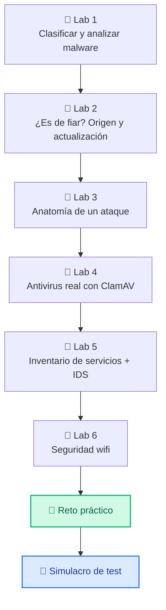
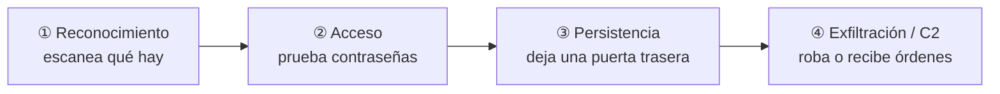

# Unidad 2 · Seguridad activa: defender un sistema en marcha

> **Módulo:** CMO-314 · Ciberseguridad · **RA2** · **Duración:** 16 h · **Peso:** 20 % · **Herramientas:** Python 3 + Docker

Si la UT1 iba de **proteger datos**, esta va de **defender un sistema que está funcionando**: reconocer el malware que lo amenaza, comprobar que lo que instalas es de fiar y está actualizado, entender cómo entra un atacante paso a paso, y montar las defensas que lo detectan y lo frenan (antivirus, inventario de servicios, sistemas de detección de intrusiones).

Lo vas a aprender como se hace en el mundo real: con **laboratorios**. Cada laboratorio es un montaje pequeño, en tu ordenador o en Docker, que haces **paso a paso** y del que sacas una conclusión. No hay que memorizar: hay que **montarlo y verlo funcionar**.

!!! info "Esta unidad se evalúa con test"
    La UD1 y la UD2 forman el **1.er trimestre**, que se evalúa con un **examen tipo test**. Los laboratorios y los ejercicios **no puntúan**: son tu forma de entender la materia y de llegar preparado/a al test. Al final tienes un **simulacro** calcado al examen.

## Qué vas a montar (mapa de laboratorios)



| Lab | Qué montas | Criterios del RA2 que tocas |
|---|---|---|
| 1 | Clasificador de amenazas + análisis de una muestra inerte | 2.a, 2.d |
| 2 | Verificador de origen (checksum) y de actualizaciones | 2.b |
| 3 | Reconstructor de las fases de un ataque a partir de un log | 2.c |
| 4 | Antivirus **ClamAV** en Docker contra el fichero EICAR | 2.d, 2.e |
| 5 | Inventario de servicios de red + mini-IDS por reglas | 2.h, 2.i |
| 6 | Análisis de la seguridad de redes wifi | 2.g |

> **Nota.** El cifrado, las firmas y los certificados (criterio 2.f) ya los montaste en la UT1, así que aquí no se repiten: lo que allí aprendiste es exactamente lo que se usa para proteger el tráfico en redes públicas.

!!! danger "La norma de siempre"
    Todo esto se practica **solo** en tu equipo, en los contenedores que montes, o en el laboratorio de clase. Analizar malware, escanear servicios o auditar wifis **ajenas** sin permiso es delito. Ver [Uso ético y legal](../recursos/uso-etico.md).

## 0 · Prepara el entorno

Necesitas Python 3 y **Docker** (lo usarás en los labs 4 y 5). Comprueba que están:

```bash title="Terminal"
python --version      # 3.10 o superior
docker --version      # cualquier versión reciente
```

Crea una carpeta `ut2-labs` y trabaja ahí. Cada laboratorio te dice qué ficheros crear.

## Lab 1 · Clasificar y analizar malware (CE 2.a, 2.d)

**Objetivo:** reconocer las familias de malware y analizar una "muestra" sospechosa **sin ejecutarla**, en un entorno controlado.

### 1.1 Las familias de malware

El **malware** (software malicioso) se clasifica por **cómo se comporta**:

| Familia | Qué hace | ¿Se propaga sola? |
|---|---|---|
| **Virus** | Se pega a un fichero y se activa al abrirlo | No, necesita que ejecutes el fichero |
| **Gusano** | Se copia solo por la red de equipo en equipo | Sí |
| **Troyano** | Se disfraza de programa útil | No, te engaña para instalarlo |
| **Ransomware** | Cifra tus ficheros y pide rescate | A menudo sí (como un gusano) |
| **Spyware** | Espía en silencio (teclas, contraseñas) | No |
| **Adware** | Inunda de publicidad | No |
| **Rootkit** | Se esconde en lo más profundo del sistema | No |

**Paso 1.** Crea `catalogo.py` y clasifica amenazas reales conocidas:

```python title="catalogo.py"
from dataclasses import dataclass

@dataclass
class Amenaza:
    nombre: str
    familia: str
    se_propaga_sola: bool

CATALOGO = [
    Amenaza("ILOVEYOU", "gusano", True),
    Amenaza("WannaCry", "ransomware", True),
    Amenaza("Zeus", "troyano", False),
    Amenaza("Pegasus", "spyware", False),
]

for a in CATALOGO:
    modo = "se propaga sola" if a.se_propaga_sola else "necesita acción del usuario"
    print(f"{a.nombre:10} -> {a.familia:11} ({modo})")
```

```text title="Salida"
ILOVEYOU   -> gusano      (se propaga sola)
WannaCry   -> ransomware  (se propaga sola)
Zeus       -> troyano     (necesita acción del usuario)
Pegasus    -> spyware     (necesita acción del usuario)
```

### 1.2 Analizar una muestra por su firma (sin ejecutarla)

Un antivirus no "ejecuta" el malware para ver qué hace: lo reconoce por su **firma**, que no es más que el **hash** del fichero (¡lo que aprendiste en la UT1!). Si el hash coincide con uno de su base de datos de amenazas, lo detecta.

**Paso 2.** Crea `analizador.py`. Usaremos el fichero **EICAR**, un texto inofensivo que todos los antivirus reconocen como "virus de prueba" (sirve justo para esto, sin ningún riesgo):

```python title="analizador.py"
import hashlib

# Mini "base de datos de firmas" de un antivirus
FIRMAS_CONOCIDAS = {
    "275a021bbfb6489e54d471899f7db9d1663fc695ec2fe2a2c4538aabf651fd0f":
        "EICAR (fichero de prueba de antivirus)",
}

def analizar(contenido: bytes) -> str:
    firma = hashlib.sha256(contenido).hexdigest()
    return FIRMAS_CONOCIDAS.get(firma, "limpio (no está en la base de firmas)")

eicar = rb'X5O!P%@AP[4\PZX54(P^)7CC)7}$EICAR-STANDARD-ANTIVIRUS-TEST-FILE!$H+H*'
print("Muestra EICAR :", analizar(eicar))
print("Fichero normal:", analizar(b"mis apuntes de clase"))
```

```text title="Salida"
Muestra EICAR : EICAR (fichero de prueba de antivirus)
Fichero normal: limpio (no está en la base de firmas)
```

!!! warning "Límite de las firmas"
    Detectar por hash tiene un punto débil: si el atacante cambia **un solo byte** del malware, su hash cambia y la firma ya no lo reconoce. Por eso los antivirus modernos añaden **análisis de comportamiento** (heurística): observan lo que el programa *intenta hacer*, no solo su hash.

!!! tip "Billete de salida del Lab 1"
    Explica con tus palabras: ¿por qué un gusano es más peligroso para una red de oficina que un troyano? ¿Y por qué cambiar un byte de un virus lo hace invisible a la detección por firma?

---

## Lab 2 · ¿Es de fiar? Origen y actualización (CE 2.b)

**Objetivo:** antes de instalar algo, comprobar que **viene de quien dice** y que el sistema está **al día**. Dos de los agujeros más explotados: instalar software manipulado y tener programas viejos con fallos conocidos.

### 2.1 Verificar el origen con el checksum publicado

Cuando descargas software serio, el fabricante publica el **hash SHA-256** del fichero. Si el de tu descarga coincide, nadie lo ha manipulado por el camino.

**Paso 1.** Crea `verificar_descarga.py`:

```python title="verificar_descarga.py"
import hashlib

def descarga_integra(fichero: bytes, checksum_publicado: str) -> bool:
    return hashlib.sha256(fichero).hexdigest() == checksum_publicado.strip().lower()

# Simulamos: descargamos un instalador y el fabricante publicó su checksum
instalador = b"contenido-del-instalador-v2.1"
checksum_oficial = hashlib.sha256(instalador).hexdigest()

print("Descarga legítima  :", descarga_integra(instalador, checksum_oficial))
print("Descarga manipulada:", descarga_integra(b"instalador+malware", checksum_oficial))
```

```text title="Salida"
Descarga legítima  : True
Descarga manipulada: False
```

> En Linux esto se hace a diario con `sha256sum fichero.iso` y comparando con el valor de la web oficial. Aquí lo has programado tú.

### 2.2 Comprobar el estado de actualización

Un programa desactualizado es una puerta abierta: sus fallos de seguridad ya son públicos. Hay que saber **qué está viejo**.

**Paso 2.** Crea `actualizaciones.py`:

```python title="actualizaciones.py"
def necesita_actualizar(instalada: str, ultima: str) -> bool:
    actual = [int(x) for x in instalada.split(".")]
    nueva = [int(x) for x in ultima.split(".")]
    return actual < nueva

# Inventario: (versión instalada, última disponible)
paquetes = {
    "openssl": ("3.0.2", "3.0.13"),
    "nginx":   ("1.24.0", "1.24.0"),
    "python":  ("3.10.6", "3.12.1"),
}

for nombre, (instalada, ultima) in paquetes.items():
    estado = "⚠️ ACTUALIZAR" if necesita_actualizar(instalada, ultima) else "al día"
    print(f"{nombre:8} {instalada:9} -> {ultima:9} {estado}")
```

```text title="Salida"
openssl  3.0.2     -> 3.0.13    ⚠️ ACTUALIZAR
nginx    1.24.0    -> 1.24.0    al día
python   3.10.6    -> 3.12.1    ⚠️ ACTUALIZAR
```

> Comparar la versión como **lista de números** (`[3, 0, 2] < [3, 0, 13]`) funciona bien incluso con `1.9` vs `1.10`, cosa que fallaría si lo compararas como texto.

!!! tip "Billete de salida del Lab 2"
    ¿Por qué un atacante prefiere un servidor con software viejo? Busca en qué consiste un **CVE** y pon un ejemplo de uno famoso.

---

## Lab 3 · Anatomía de un ataque (CE 2.c)

**Objetivo:** un ataque casi nunca es un único golpe: sigue **fases** (reconocer → entrar → afianzarse → actuar). Si reconoces las fases en los registros, puedes cortar el ataque antes de que llegue al final.



**Paso 1.** Crea `anatomia.py` con el registro de un ataque real y clasifica cada línea en su fase:

```python title="anatomia.py"
LOG = """\
08:00 203.0.113.9 escaneo de puertos 22,80,443
08:05 203.0.113.9 intento ssh usuario=root FALLO
08:06 203.0.113.9 intento ssh usuario=root FALLO
08:07 203.0.113.9 intento ssh usuario=root OK
08:10 203.0.113.9 descarga /tmp/puerta_trasera.sh
08:15 203.0.113.9 conexion saliente a 198.51.100.4:4444"""

def fase(linea: str) -> str:
    if "escaneo" in linea:   return "1-Reconocimiento"
    if "FALLO" in linea:     return "2-Intento de acceso"
    if "OK" in linea:        return "3-Acceso conseguido"
    if "descarga" in linea:  return "4-Persistencia"
    if "saliente" in linea:  return "5-Exfiltración/C2"
    return "?"

for linea in LOG.splitlines():
    print(f"[{fase(linea):20}] {linea}")
```

```text title="Salida"
[1-Reconocimiento    ] 08:00 203.0.113.9 escaneo de puertos 22,80,443
[2-Intento de acceso ] 08:05 203.0.113.9 intento ssh usuario=root FALLO
[2-Intento de acceso ] 08:06 203.0.113.9 intento ssh usuario=root FALLO
[3-Acceso conseguido ] 08:07 203.0.113.9 intento ssh usuario=root OK
[4-Persistencia      ] 08:10 203.0.113.9 descarga /tmp/puerta_trasera.sh
[5-Exfiltración/C2   ] 08:15 203.0.113.9 conexion saliente a 198.51.100.4:4444
```

> Las 5 fases se corresponden con las de la **Cyber Kill Chain** (Lockheed Martin) y el marco **MITRE ATT&CK**, el vocabulario estándar que usan los equipos de seguridad. **Medida preventiva:** bloquear la IP tras los primeros FALLO (fase 2) habría cortado el ataque antes del acceso.

!!! tip "Billete de salida del Lab 3"
    Para cada fase, propón **una** contramedida (preventiva o paliativa). Por ejemplo, en la fase 2: limitar los intentos de login.

---

## Lab 4 · Antivirus real: ClamAV en Docker (CE 2.d, 2.e)

**Objetivo:** montar un **antivirus de verdad** (ClamAV, libre y muy usado) en un contenedor y lanzarlo contra el fichero EICAR del Lab 1. Aquí no simulas: usas la herramienta real.

**Paso 1.** Crea una carpeta `muestras` y mete dentro el fichero EICAR y uno limpio:

```bash title="Terminal"
mkdir muestras
printf 'X5O!P%%@AP[4\PZX54(P^)7CC)7}$EICAR-STANDARD-ANTIVIRUS-TEST-FILE!$H+H*' > muestras/sospechoso.txt
echo "estos son mis apuntes" > muestras/apuntes.txt
```

**Paso 2.** Lanza ClamAV en Docker apuntando a esa carpeta. La imagen oficial `clamav/clamav` trae el motor y las firmas:

```bash title="Terminal"
docker run --rm -v "$PWD/muestras:/scan" clamav/clamav:latest clamscan -v /scan
```

**Paso 3.** Observa el informe. ClamAV detecta el EICAR y deja en paz el fichero de apuntes:

```text title="Salida (resumida)"
/scan/apuntes.txt: OK
/scan/sospechoso.txt: Win.Test.EICAR_HDB-1 FOUND

----------- SCAN SUMMARY -----------
Infected files: 1
```

> `Win.Test.EICAR_HDB-1 FOUND` es exactamente lo que verías con un virus real: el nombre de la amenaza y la palabra `FOUND`. La diferencia es que EICAR es inofensivo. **Esto es el criterio 2.e en acción:** una aplicación específica que detecta y permitiría eliminar el software malicioso (`clamscan --remove`).

!!! warning "La primera vez tarda"
    ClamAV descarga su base de firmas al arrancar (unos minutos la primera vez). Si tu red del aula lo bloquea, el profesor puede dar una imagen con las firmas ya incluidas.

!!! tip "Billete de salida del Lab 4"
    ¿Qué diferencia hay entre `clamscan` (bajo demanda) y un antivirus "residente" que vigila en tiempo real? ¿Cuándo usarías cada uno?

---

## Lab 5 · Inventario de servicios + mini-IDS (CE 2.h, 2.i)

**Objetivo:** dos defensas clave. Primero, saber **qué puertas tiene abiertas** tu sistema (no puedes proteger lo que no sabes que existe). Después, un **IDS** (sistema de detección de intrusiones) que vigila el tráfico y avisa de lo sospechoso.

### 5.1 Inventario de servicios de red

En Linux, `ss -tlnp` lista los servicios que están **escuchando**. Vamos a procesar esa salida y marcar los puertos que **no** deberían estar abiertos.

**Paso 1.** Crea `inventario.py`:

```python title="inventario.py"
import re

# Salida simplificada de 'ss -tlnp' (puerto y servicio que escucha)
SS = """\
tcp LISTEN 0.0.0.0:22 sshd
tcp LISTEN 0.0.0.0:80 nginx
tcp LISTEN 0.0.0.0:23 telnetd
tcp LISTEN 127.0.0.1:5432 postgres"""

AUTORIZADOS = {22, 80, 443}

def inventariar(salida: str) -> None:
    for linea in salida.splitlines():
        m = re.search(r":(\d+)\s+(\S+)$", linea)
        if m:
            puerto, servicio = int(m.group(1)), m.group(2)
            estado = "autorizado" if puerto in AUTORIZADOS else "⚠️ NO autorizado"
            print(f"puerto {puerto:5} {servicio:10} {estado}")

inventariar(SS)
```

```text title="Salida"
puerto    22 sshd       autorizado
puerto    80 nginx      autorizado
puerto    23 telnetd    ⚠️ NO autorizado
puerto  5432 postgres   ⚠️ NO autorizado
```

> El puerto **23 (Telnet)** manda las contraseñas **sin cifrar**: nunca debería estar abierto. El **5432 (PostgreSQL)** solo escucha en `127.0.0.1` (localhost), así que no es accesible desde fuera — menos grave, pero conviene saberlo. **Esto es el criterio 2.h:** inventariar y controlar los servicios que corren.

### 5.2 Un mini-IDS por reglas

Un **IDS** vigila el tráfico y lanza una alerta cuando algo encaja con una **regla** de ataque conocido. Herramientas reales como **Snort** o **Suricata** funcionan así, con miles de reglas. Montamos uno en pequeño.

**Paso 2.** Crea `ids.py`:

```python title="ids.py"
REGLAS = [
    ("backdoor Metasploit (puerto 4444)", lambda l: ":4444" in l),
    ("acceso al fichero de contraseñas",  lambda l: "/etc/shadow" in l),
    ("herramienta de ataque sqlmap",      lambda l: "sqlmap" in l.lower()),
]

def detectar(linea: str) -> list[str]:
    return [descripcion for descripcion, regla in REGLAS if regla(linea)]

trafico = [
    "GET /index.html",
    "conexion a 10.0.0.5:4444",
    "cat /etc/shadow",
    'GET / User-Agent: sqlmap/1.7',
]
for linea in trafico:
    alertas = detectar(linea)
    marca = "🚨 " + "; ".join(alertas) if alertas else "ok"
    print(f"{linea[:32]:34} {marca}")
```

```text title="Salida"
GET /index.html                    ok
conexion a 10.0.0.5:4444           🚨 backdoor Metasploit (puerto 4444)
cat /etc/shadow                    🚨 acceso al fichero de contraseñas
GET / User-Agent: sqlmap/1.7       🚨 herramienta de ataque sqlmap
```

> Hay dos tipos de IDS: **NIDS** (vigila la *red*, como Snort) y **HIDS** (vigila un *equipo* concreto, como tus ficheros). El tuyo, leyendo líneas de tráfico, es un NIDS en miniatura. **Esto es el criterio 2.i.**

!!! tip "Billete de salida del Lab 5"
    ¿Qué diferencia un **IDS** (detecta y avisa) de un **IPS** (detecta y además bloquea)? ¿Y un cortafuegos de un IDS?

---

## Lab 6 · Seguridad de redes wifi (CE 2.g)

**Objetivo:** entender por qué unas wifis son seguras y otras no, evaluando el **protocolo de cifrado** que usan. No vamos a atacar ninguna red (sería ilegal): vamos a **evaluar** redes a partir de sus datos, como hace cualquier auditor.

Los protocolos de seguridad wifi, de peor a mejor:

| Protocolo | Estado | Por qué |
|---|---|---|
| **Abierta** (sin clave) | ☠️ Peligrosa | Cualquiera lee tu tráfico |
| **WEP** | ☠️ Roto | Se rompe en minutos, de 2001 |
| **WPA** | ⚠️ Débil | Obsoleto |
| **WPA2** | ✅ Aceptable | El estándar durante años |
| **WPA3** | ✅ Recomendado | El más moderno |

**Paso 1.** Crea `auditor_wifi.py`. Evalúa una lista de redes (como las que ves al conectarte) y puntúa su seguridad:

```python title="auditor_wifi.py"
NIVEL = {"abierta": 0, "WEP": 1, "WPA": 2, "WPA2": 4, "WPA3": 5}

def evaluar(red: dict) -> str:
    puntos = NIVEL.get(red["seguridad"], 0)
    if puntos <= 1:
        return "☠️ EVITAR"
    if puntos <= 2:
        return "⚠️ DÉBIL"
    return "✅ OK"

redes = [
    {"nombre": "WiFi_Cafe_Gratis", "seguridad": "abierta"},
    {"nombre": "MOVISTAR_1234",     "seguridad": "WEP"},
    {"nombre": "casa_ana",          "seguridad": "WPA2"},
    {"nombre": "oficina_5G",        "seguridad": "WPA3"},
]
for red in redes:
    print(f"{red['nombre']:20} {red['seguridad']:8} {evaluar(red)}")
```

```text title="Salida"
WiFi_Cafe_Gratis     abierta  ☠️ EVITAR
MOVISTAR_1234        WEP      ☠️ EVITAR
casa_ana             WPA2     ✅ OK
oficina_5G           WPA3     ✅ OK
```

**Paso 2 (reflexión).** Una wifi **abierta** de cafetería no cifra nada: cualquiera en el local puede leer lo que envías. ¿Significa que no puedes usarla? No, si **tú** cifras por encima: cuando entras en una web `https://`, tu tráfico va cifrado de extremo a extremo (es el cifrado de la UT1 en acción), aunque la wifi sea abierta. Por eso el candado de HTTPS es tu salvavidas en redes públicas.

!!! tip "Billete de salida del Lab 6"
    ¿Por qué WEP se considera "roto" y no solo "débil"? ¿Qué puedes hacer para navegar con cierta seguridad en una wifi abierta?

---

## 🎯 Reto práctico (para que lo montes tú)

Has montado seis laboratorios por separado. Ahora júntalos en una sola herramienta: un **centinela** que lee el registro de un servidor y saca un informe de seguridad.

**Qué tiene que hacer `centinela.py`:** leer un log como este y producir un informe con (1) los fallos de acceso por IP, (2) las IPs **críticas** —las que fallaron 3 veces o más **y luego** consiguieron entrar— y (3) las alertas del IDS (conexiones al puerto 4444).

```python title="log de ejemplo para probar"
LOG = """\
10:00 198.51.100.7 escaneo de puertos
10:01 198.51.100.7 intento ssh usuario=admin FALLO
10:02 198.51.100.7 intento ssh usuario=admin FALLO
10:03 198.51.100.7 intento ssh usuario=admin FALLO
10:04 192.168.1.50 GET /index.html
10:05 198.51.100.7 intento ssh usuario=admin OK
10:06 198.51.100.7 descarga /tmp/shell.sh
10:07 198.51.100.7 conexion saliente a 203.0.113.9:4444"""
```

**Salida que debes conseguir:**

```text
Fallos por IP: {'198.51.100.7': 3}
IPs críticas (fuerza bruta + acceso): ['198.51.100.7']
Alertas IDS: ['198.51.100.7: posible backdoor (puerto 4444)']
```

**Pistas:**

- Extrae la IP de cada línea con una expresión regular (`\d+\.\d+\.\d+\.\d+`), como en la UT... bueno, como aprenderás a hacer con `re`.
- Cuenta los `FALLO` por IP con `collections.Counter`.
- Guarda en un conjunto las IPs que tienen una línea con `OK`.
- Una IP es **crítica** si está en los dos sitios: muchos fallos **y** un acceso correcto.
- Para el IDS, busca `":4444"` en la línea.

**Si te sobra tiempo:** añade que detecte también la **fase** de cada línea (Lab 3) y que marque el puerto `23` si aparece (Lab 5).

> Este reto es solo para practicar: **no se entrega ni puntúa**. Pero si lo resuelves, el simulacro te va a resultar fácil.

---

## Resumen de la unidad

| Criterio | Idea para el test |
|---|---|
| 2.a Tipos de malware | Virus (necesita abrirse), gusano (se propaga solo), troyano (se disfraza), ransomware (cifra y extorsiona), spyware (espía), rootkit (se esconde) |
| 2.b Origen y actualización | Verifica el **checksum** publicado; mantén todo **actualizado** (lo viejo tiene fallos públicos) |
| 2.c Anatomía del ataque | Fases: reconocimiento → acceso → persistencia → exfiltración/C2 |
| 2.d Analizar malware | En entorno **controlado**, sin ejecutarlo; por **firma** (hash) |
| 2.e Antivirus | Herramientas como **ClamAV** detectan (firma) y eliminan; `FOUND` = amenaza |
| 2.f Cripto en redes | Ya en la UT1: cifrado, firma y certificados protegen el tráfico (HTTPS) |
| 2.g Wifi | Abierta/WEP = evitar · WPA2/WPA3 = ok · en wifi abierta, confía en HTTPS |
| 2.h Servicios de red | **Inventaría** lo que escucha (`ss -tlnp`); cierra lo que no se use (ej. Telnet/23) |
| 2.i IDS | Detecta intrusiones por reglas; **NIDS** (red, como Snort) vs **HIDS** (equipo) |

## Autoevaluación rápida (conceptos)

<details><summary>1. ¿Por qué un gusano es más peligroso en una red que un troyano?</summary>El gusano se propaga solo de equipo a equipo; el troyano necesita que alguien lo instale.</details>
<details><summary>2. ¿Cómo detecta un antivirus un virus sin ejecutarlo?</summary>Por su firma: compara el hash del fichero con su base de datos de amenazas.</details>
<details><summary>3. ¿Por qué cambiar un byte de un virus lo hace invisible a la detección por firma?</summary>Porque cambia su hash, así que ya no coincide con la firma guardada. Por eso se usa también análisis de comportamiento.</details>
<details><summary>4. ¿Qué servicio de red nunca deberías dejar abierto y por qué?</summary>Telnet (puerto 23): envía las contraseñas sin cifrar.</details>
<details><summary>5. ¿Qué diferencia hay entre un IDS y un IPS?</summary>El IDS detecta y avisa; el IPS además bloquea el ataque.</details>
<details><summary>6. En una wifi abierta de una cafetería, ¿cómo navegas con cierta seguridad?</summary>Usando webs HTTPS: tu tráfico va cifrado de extremo a extremo aunque la wifi no cifre nada.</details>

## Glosario

| Término | Definición |
|---|---|
| **Malware** | Software malicioso: virus, gusano, troyano, ransomware, spyware, rootkit. |
| **Firma (antivirus)** | Hash de un fichero malicioso conocido, usado para detectarlo. |
| **EICAR** | Fichero de prueba inofensivo que todos los antivirus detectan como "virus". |
| **Checksum** | Hash publicado por el fabricante para verificar que una descarga no se ha manipulado. |
| **CVE** | Identificador público de una vulnerabilidad conocida. |
| **Kill chain** | Las fases de un ataque, de reconocimiento a exfiltración. |
| **ClamAV** | Antivirus libre, muy usado en servidores Linux. |
| **IDS / IPS** | Detecta intrusiones y avisa / detecta y además bloquea. |
| **NIDS / HIDS** | IDS que vigila la red / IDS que vigila un equipo concreto. |
| **WPA2 / WPA3** | Protocolos de cifrado wifi seguros (WEP y "abierta" no lo son). |

## Cómo se evalúa esta unidad (RA2)

La UD1 y la UD2 forman el **1.er trimestre**, que se evalúa con un **examen tipo test** (preguntas de 4 opciones como las del simulacro).

!!! tip "La nota, sin sorpresas"
    **Nota = (aciertos ÷ nº de preguntas) × 10.** Los fallos no restan. Se aprueba con 5.

Los laboratorios y el reto **no puntúan**: son tu entrenamiento. Si haces el simulacro sin mirar y sacas más de 14 de 20, vas bien.

## Simulacro de examen tipo test

> 20 preguntas de opción múltiple sobre toda la unidad. Hazlo como si fuera el examen: sin mirar, y al final corrige.

**1.** Un malware se copia solo de un ordenador a otro por la red, sin que nadie abra nada. ¿Qué familia es?

A) Virus
B) Troyano
C) Gusano
D) Spyware

<details class="sol"><summary>Ver respuesta</summary><b>Correcta: C.</b> El gusano se propaga solo por la red; el virus necesita que se ejecute un fichero y el troyano que alguien lo instale engañado.</details>

**2.** Un programa que se hace pasar por un juego gratuito pero instala una puerta trasera es un…

A) Gusano
B) Troyano
C) Rootkit
D) Adware

<details class="sol"><summary>Ver respuesta</summary><b>Correcta: B.</b> El troyano se disfraza de software legítimo para que lo instales tú mismo.</details>

**3.** ¿Cómo detecta un antivirus un fichero malicioso **sin ejecutarlo**?

A) Lo abre en una máquina virtual
B) Compara su hash (firma) con una base de amenazas conocidas
C) Mira su extensión
D) Pregunta al usuario

<details class="sol"><summary>Ver respuesta</summary><b>Correcta: B.</b> La detección por firma es comparar el hash del fichero con los de malware conocido.</details>

**4.** ¿Cuál es el punto débil de la detección **por firma**?

A) Es muy lenta
B) Si el atacante cambia un byte, el hash cambia y ya no se reconoce
C) Solo funciona en Windows
D) Necesita conexión a internet

<details class="sol"><summary>Ver respuesta</summary><b>Correcta: B.</b> Un cambio mínimo altera el hash; por eso se complementa con análisis de comportamiento (heurística).</details>

**5.** El fichero **EICAR** sirve para…

A) Infectar un equipo de prueba
B) Comprobar que un antivirus funciona, sin ningún riesgo
C) Cifrar ficheros
D) Borrar virus

<details class="sol"><summary>Ver respuesta</summary><b>Correcta: B.</b> Es un fichero inofensivo que todos los antivirus reconocen como "virus de prueba".</details>

**6.** Antes de instalar un programa descargado, ¿cómo compruebas que no lo han manipulado?

A) Comprobando que el antivirus no salta
B) Comparando su hash con el checksum publicado por el fabricante
C) Mirando el tamaño del fichero
D) Ejecutándolo y viendo si funciona

<details class="sol"><summary>Ver respuesta</summary><b>Correcta: B.</b> Si el hash de tu descarga coincide con el checksum oficial, el fichero es idéntico al original.</details>

**7.** ¿Qué devuelve esta función?

```python
def necesita_actualizar(instalada, ultima):
    return [int(x) for x in instalada.split(".")] < [int(x) for x in ultima.split(".")]

print(necesita_actualizar("2.9.0", "2.10.0"))
```

A) `True`
B) `False`
C) Error
D) `2.10.0`

<details class="sol"><summary>Ver respuesta</summary><b>Correcta: A.</b> Comparadas como listas de números, `[2,9,0] < [2,10,0]` es cierto (9 es menor que 10). Como texto fallaría, pero aquí son enteros.</details>

**8.** ¿Por qué es peligroso un servidor con software desactualizado?

A) Va más lento
B) Sus fallos de seguridad ya son públicos y fáciles de explotar
C) Ocupa más disco
D) No es peligroso

<details class="sol"><summary>Ver respuesta</summary><b>Correcta: B.</b> Las vulnerabilidades conocidas (CVE) de versiones viejas están documentadas y hay exploits listos para usar.</details>

**9.** Ordena las fases típicas de un ataque:

A) Acceso → Reconocimiento → Persistencia → Exfiltración
B) Reconocimiento → Acceso → Persistencia → Exfiltración
C) Persistencia → Acceso → Reconocimiento → Exfiltración
D) Reconocimiento → Persistencia → Acceso → Exfiltración

<details class="sol"><summary>Ver respuesta</summary><b>Correcta: B.</b> Primero se mira qué hay (reconocimiento), luego se entra (acceso), se asegura la entrada (persistencia) y finalmente se actúa (exfiltración/C2).</details>

**10.** En un log ves 6 intentos de login `FALLO` seguidos desde la misma IP. ¿En qué fase del ataque estás y qué contramedida corta el ataque ahí?

A) Persistencia; reinstalar el sistema
B) Intento de acceso; limitar/bloquear tras N fallos
C) Exfiltración; apagar la red
D) Reconocimiento; cambiar la IP del servidor

<details class="sol"><summary>Ver respuesta</summary><b>Correcta: B.</b> Son intentos de acceso (fuerza bruta); bloquear la IP tras varios fallos (como hace fail2ban) corta el ataque antes del acceso.</details>

**11.** Al escanear un servidor con ClamAV ves `sospechoso.txt: Win.Test.EICAR_HDB-1 FOUND`. ¿Qué significa?

A) El fichero está limpio
B) ClamAV ha detectado una amenaza en ese fichero
C) Hubo un error de escaneo
D) El fichero no existe

<details class="sol"><summary>Ver respuesta</summary><b>Correcta: B.</b> `FOUND` indica detección; el texto anterior es el nombre de la amenaza identificada.</details>

**12.** ¿Qué criterio del RA2 cubre el uso de ClamAV?

A) Inventariar servicios de red
B) Implantar aplicaciones para detectar y eliminar software malicioso
C) Evaluar la seguridad wifi
D) Verificar certificados digitales

<details class="sol"><summary>Ver respuesta</summary><b>Correcta: B.</b> ClamAV es una aplicación específica de detección y eliminación de malware (criterio 2.e).</details>

**13.** ¿Qué hace este código?

```python
import re
m = re.search(r":(\d+)\s+(\S+)$", "tcp LISTEN 0.0.0.0:23 telnetd")
print(m.group(1), m.group(2))
```

A) `23 telnetd`
B) `telnetd 23`
C) `0.0.0.0 23`
D) Error

<details class="sol"><summary>Ver respuesta</summary><b>Correcta: A.</b> El primer grupo captura el puerto (`23`) y el segundo el servicio (`telnetd`).</details>

**14.** ¿Por qué el puerto **23 (Telnet)** no debería estar abierto?

A) Es muy lento
B) Envía las contraseñas sin cifrar
C) Solo funciona en Windows
D) Consume mucha memoria

<details class="sol"><summary>Ver respuesta</summary><b>Correcta: B.</b> Telnet transmite todo en claro, incluidas las credenciales; su sustituto seguro es SSH (puerto 22).</details>

**15.** ¿Por qué conviene **inventariar** los servicios de red que escuchan en un sistema?

A) Para que vaya más rápido
B) No puedes proteger ni cerrar lo que no sabes que está abierto
C) Para ahorrar electricidad
D) Es obligatorio por ley

<details class="sol"><summary>Ver respuesta</summary><b>Correcta: B.</b> Conocer la superficie de ataque (qué puertas hay abiertas) es el primer paso para reducirla.</details>

**16.** Un **IDS** y un **IPS** se diferencian en que…

A) El IDS es más caro
B) El IDS detecta y avisa; el IPS además bloquea el ataque
C) El IPS solo funciona en la nube
D) Son lo mismo

<details class="sol"><summary>Ver respuesta</summary><b>Correcta: B.</b> Detección (IDS) frente a detección + prevención/bloqueo (IPS).</details>

**17.** ¿Qué diferencia a un **NIDS** de un **HIDS**?

A) El NIDS vigila la red; el HIDS vigila un equipo concreto
B) El NIDS es para Windows y el HIDS para Linux
C) El NIDS es un antivirus
D) No hay diferencia

<details class="sol"><summary>Ver respuesta</summary><b>Correcta: A.</b> NIDS (Network, como Snort/Suricata) vigila el tráfico de red; HIDS vigila los ficheros y la actividad de un host.</details>

**18.** ¿Cuál de estas redes wifi es la **más insegura**?

A) WPA3
B) WPA2
C) WEP
D) Una red con contraseña larga y WPA2

<details class="sol"><summary>Ver respuesta</summary><b>Correcta: C.</b> WEP está roto desde hace años y se descifra en minutos; WPA2 y WPA3 son seguros.</details>

**19.** Estás en una wifi **abierta** de una cafetería. ¿Cómo proteges tu tráfico?

A) No se puede, hay que desconectarse
B) Usando webs HTTPS, que cifran de extremo a extremo
C) Poniéndole contraseña a la wifi
D) Apagando el bluetooth

<details class="sol"><summary>Ver respuesta</summary><b>Correcta: B.</b> Aunque la wifi no cifre, HTTPS protege tu tráfico de extremo a extremo (el cifrado de la UT1 en acción). Una VPN también valdría.</details>

**20.** ¿Qué imprime `analizar(b"hola")` con esta base de firmas?

```python
import hashlib
FIRMAS = {"275a021bbfb6489e54d471899f7db9d1663fc695ec2fe2a2c4538aabf651fd0f": "EICAR"}

def analizar(contenido):
    return FIRMAS.get(hashlib.sha256(contenido).hexdigest(), "limpio")

print(analizar(b"hola"))
```

A) `EICAR`
B) `limpio`
C) El hash de "hola"
D) Error

<details class="sol"><summary>Ver respuesta</summary><b>Correcta: B.</b> El hash de `b"hola"` no está en la base de firmas, así que <code>.get</code> devuelve el valor por defecto <code>"limpio"</code>.</details>
